<p align="center">
  <picture>
    <source media="(prefers-color-scheme: dark)" srcset="docs/assets/tracewise-logo-tagline-on-dark.svg">
    
  </picture>
</p>

<p align="center">
  <strong>Evidence-backed diagnosis for failed GitHub Actions runs.</strong>
</p>

<p align="center">
  <a href="https://github.com/Rarebuffalo/tracewise/actions/workflows/ci.yml"></a>
  
  
</p>

<p align="center">
  <a href="#quick-start">Quick start</a> ·
  <a href="docs/ARCHITECTURE.md">Architecture</a> ·
  <a href="docs/DEVELOPMENT.md">Development</a> ·
  <a href="docs/TESTING.md">Testing</a> ·
  <a href="SECURITY.md">Security</a> ·
  <a href="CONTRIBUTING.md">Contributing</a>
</p>

---

Tracewise is a GitHub App that diagnoses failed GitHub Actions runs. When a workflow run fails, it reads the failed
jobs' logs and the code at the failing commit and runs a bounded, read-only investigation. It publishes a short
report back to GitHub (a Check Run, plus a PR comment or a commit comment). Every claim in the report must be backed
by evidence it actually examined. When the evidence is not enough, the report says **"inconclusive"** instead of
guessing.

> **Status: pre-release, not production-ready.** The offline implementation is complete and heavily tested, but it
> has **not** been run against live GitHub, no real AI model has been connected, and there is no hosted deployment.
> See [Project status](#project-status-and-limitations).

---

## Why Tracewise

A red CI run usually means scrolling through thousands of log lines, then reading code to work out which error
matters and why. Generic AI summaries can speed that up, but they also invent plausible causes. Tracewise is built
the other way round:

- **Evidence first.** A deterministic pre-pass finds the primary error lines before any model is involved. It
  separates one failure repeated many times from several independent failures, and recognises cascades such as a
  `ModuleNotFoundError` after an install failure.
- **Bounded and read-only.** The investigator may only `read_file`, `grep`, `list_dir` and `get_diff`, with at
  most 12 calls and 120 seconds. It cannot run code, write files or reach the network.
- **Validated output.** A validator checks every cited path, line and URL against what was really examined. It
  strips causal claims about the triggering commit and unsafe commands, and enforces confidence rules. Anything it
  cannot support becomes "inconclusive".
- **Safe publication.** Reports are idempotent (re-runs update in place, never duplicate), authorisation is
  re-checked before every surface, and untrusted text can never become a link, a mention or a report marker.

## How it works

```mermaid
flowchart LR
  GH[GitHub Actions run fails] -- "workflow_run webhook (HMAC-SHA256)" --> WEB["web: verify signature, dedupe,<br/>record delivery + job (one transaction)"]
  WEB --> Q[("PostgreSQL durable queue<br/>(leases, bounded retries, 10-min deadline)")]
  Q --> W[worker]
  W --> EV["evidence: jobs API, failed-step logs (redacted, bounded),<br/>trigger diff, code at the failing commit"]
  EV --> PRE["deterministic pre-pass:<br/>primary errors, cascades, fingerprints"]
  PRE --> INV["bounded investigation<br/>(read_file, grep, list_dir, get_diff; ≤12 calls, ≤120 s)"]
  INV --> VAL["validation: evidence, confidence,<br/>diagnosed or inconclusive"]
  VAL --> PUB["publish: Check Run + PR comment<br/>(or commit comment), re-checked per surface"]
```



1. GitHub sends a `workflow_run` webhook. The web process verifies the HMAC signature, deduplicates it and stores
   the delivery and an analysis job in one transaction.
2. A worker claims the job from the PostgreSQL queue (row locking, leases, backoff, a 10-minute job deadline).
3. It fetches the failed jobs and their logs with a short-lived, repository-scoped installation token. Logs are
   redacted and bounded.
4. The deterministic pre-pass extracts primary errors from pytest, Python tracebacks, ruff, mypy, tsc, jest,
   vitest, eslint and installer output (pip, npm, uv).
5. The investigator runs within its tool and time budget against a model provider (see the status note below).
6. The validator turns the draft into a diagnosis or an explicit "inconclusive" with next steps.
7. The publisher writes the report, re-checking that the installation still authorises it before each surface.
   Failures that leave nothing published produce a "could not complete" notice.

More detail: [docs/ARCHITECTURE.md](docs/ARCHITECTURE.md).

## Key capabilities

**Implemented and tested offline** (fakes, local PostgreSQL, recorded fixtures):

| Area | What exists |
|---|---|
| Ingestion | HMAC verification before parsing, size cap, delivery and run-attempt dedupe, lifecycle events (install, suspend, remove, transfer) |
| Queue and worker | Durable PostgreSQL queue, leases and heartbeats, bounded retries with backoff, deadlines, graceful shutdown, recovery of failed deliveries and missed runs |
| Analysis | Log retention budget with truncation flags, redaction, deterministic primary-error extraction, bounded read-only investigation, evidence validation, confidence rules |
| Publication | Check Run, PR comment, write-once commit comment; reconciliation of ambiguous writes; per-surface authorisation re-checks |
| Isolation | Tenant plane under PostgreSQL row-level security; separate system role; installation-scoped keys; role checks at startup |
| Operations | `/healthz`, `/readyz`, structured secret-safe JSON logs, an ops report and failure-rate alert, a retention purge, backup/restore verified |
| Quality | Offline benchmark harness with a frozen truth set; CI workflow with a network guard |

**Built but not yet validated externally:** every GitHub interaction (validated only against fakes and recorded
responses), and the OpenAI Responses API adapter (implemented against the recorded contract; never called).

## Tech stack

| Technology | Role |
|---|---|
| Python ≥ 3.12 (developed on 3.14) | The single package with the `web` and `worker` processes |
| FastAPI + uvicorn | Webhook endpoint and health probes |
| PostgreSQL + psycopg 3 (+ psycopg-pool) | Data store, durable job queue, row-level security |
| Alembic (+ SQLAlchemy for its runtime) | Schema migrations |
| httpx | GitHub and model-provider HTTP clients |
| pydantic / pydantic-settings | Data contracts and configuration |
| PyJWT | GitHub App authentication |
| uv, ruff, mypy (strict), pytest | Dependency management and quality gates |

There is no Redis, object store or frontend.

## Quick start

> Running the processes locally is useful for development, but **no real diagnosis is produced yet**: the only
> runnable model provider is the test fake. To see the analysis pipeline end to end, use the test suite or the
> offline benchmark below.

**Prerequisites:** [uv](https://docs.astral.sh/uv/), Python 3.12+, PostgreSQL server binaries (`initdb`,
`pg_ctl`) on `PATH`, and `git`.

```bash
uv sync
```

```bash
make check
```

`make check` runs lint, formatting, strict typing, the non-slow test suite and the documentation consistency check.
The database tests start their own disposable PostgreSQL clusters, so no database setup is needed for testing.

Run the offline benchmark with scripted providers (protocol validation, **not** model accuracy):

```bash
uv run python -m tracewise.bench verify
```

```bash
uv run python -m tracewise.bench run --provider oracle --reps 1 --out .bench-results/local
```

Running the web and worker processes against a local database (roles, migrations, environment variables) is
described step by step in [docs/DEVELOPMENT.md](docs/DEVELOPMENT.md).

### Self-hosting

Tracewise is distributed as a self-hosted GitHub App: you run it with Docker Compose on your own machine or server
and keep your database, credentials and logs. **[docs/SELF-HOSTING.md](docs/SELF-HOSTING.md)** covers a local trial
(nothing exposed), a server deployment with HTTPS, the GitHub App, upgrades, backups, resources and limitations.
With the development prerequisites above (uv and PostgreSQL server binaries) and Docker, the quickest check that
the image and stack work on your machine is:

```bash
make image-check
```

That builds the image and runs every process from it against a throwaway database with container networking
disabled. Until the real model is approved, a live installation runs the fake provider and never names a root
cause: a failed log with no recognised error line ends `inconclusive` (commit comment and Check Run), one with a
recognised error line ends `could_not_complete` (Check Run only). It proves the GitHub pipeline, not diagnosis
quality.

## Configuration

All settings come from environment variables. [`.env.example`](.env.example) lists them with placeholders, and
[docs/CONFIGURATION.md](docs/CONFIGURATION.md) explains each one. The important rules:

- Two database URLs with **different roles**: `DATABASE_URL` (tenant plane, row-level security) and
  `DATABASE_URL_SYSTEM` (system plane). Processes refuse to start on the wrong role.
- `GITHUB_WEBHOOK_SECRET` (≥16 characters), `GITHUB_APP_ID` and `GITHUB_APP_PRIVATE_KEY_PATH` come from your own
  GitHub App.
- `LLM_PROVIDER=fake` is accepted only with `TW_ENV=test`. `LLM_PROVIDER=openai` still refuses to start until the
  adapter has been validated.
- Never commit real values. `.env` files, keys and PEMs are git-ignored.

## Testing and quality

| Command | What it runs |
|---|---|
| `make check` | ruff (lint + format check), mypy strict, pytest without slow and live tests, docs check |
| `make test-all` | All non-live tests, slow included |
| `make ci` | Everything the CI workflow runs (gates, truth lock, all non-live tests under the network guard, no skips) |
| `PYTHONPATH=. uv run pytest -p tests.netguard -m "not live"` | The CI test command: everything non-live under the network guard |
| `uv run python -m tracewise.bench verify` | Confirms the benchmark truth set matches its lock |

- **Offline by design.** CI and local runs use fakes, recorded GitHub responses and disposable PostgreSQL clusters.
  The **network guard** (`tests/netguard.py`) refuses any non-loopback connection and fails the run if one is
  attempted, even when a test catches the error.
- **CI** ([`.github/workflows/ci.yml`](.github/workflows/ci.yml)) runs lint, typing, docs, the truth-lock check and
  all non-live tests. It fails if any test is skipped, so missing PostgreSQL binaries cannot hide the database
  tests.
- **Live validation is separate and not yet done:** the `live` marker and the staged plan in
  [docs/LIVE-VALIDATION-PLAN.md](docs/LIVE-VALIDATION-PLAN.md) need a dedicated test organisation.

More: [docs/TESTING.md](docs/TESTING.md).

## Security and privacy

- **Webhooks:** the HMAC-SHA256 signature is verified in constant time over the raw body before anything is parsed,
  and the body size is capped.
- **GitHub access:** short-lived installation tokens, scoped per repository and per purpose. The requested
  permissions are Actions read, Contents read, Metadata read, Pull requests write and Checks write.
- **Tenant isolation:** analysis and publication run on a PostgreSQL role subject to row-level security, with a
  transaction-local tenant id. Keys are installation-scoped.
- **Untrusted input:** logs, code and model output are treated as data. The investigator is read-only, and the
  validator removes unverified paths, links, causal claims and unsafe commands.
- **Redaction** of secret-shaped values is applied to logs, to content sent to a model provider and to stored
  snippets. It is **pattern-based**, so encoded, split or unfamiliar secrets can still pass.
- **Logging** scrubs tokens, signed URLs and auth headers; errors record classes, never values.

Report vulnerabilities as described in [SECURITY.md](SECURITY.md). Findings and evidence:
[docs/SECURITY-AUDIT.md](docs/SECURITY-AUDIT.md). Data handled: [docs/DATA-INVENTORY.md](docs/DATA-INVENTORY.md).

## Project status and limitations

| | Status |
|---|---|
| Offline implementation and tests | Complete for the specified MVP |
| Live GitHub validation (stages S0–S5) | **S0 exercised with the fake provider** (App installed 2026-10-22; publishing runs, re-runs and the redelivery 2026-10-23), from the local trial on a laptop through a tunnel, against a development App on one test repository: both fake-provider outcomes, re-runs updating the same Check Run, a redelivery rejected as a duplicate ([LIVE-VALIDATION-PLAN.md](docs/LIVE-VALIDATION-PLAN.md) §S0). G-PLAT-5 deferred. **S1–S5 not done** |
| AI model | **Not connected.** OpenAI adapter implemented offline; a single smoke call, provider activation and the accuracy evaluation each need separate approval |
| Self-hosted deployment | Docker image and Compose bundle, rehearsed locally on amd64 (local trial and server layout); the local trial received live GitHub webhooks through a tunnel for S0; **not yet run on a real server**; no production deployment; arm64 unverified |
| Accuracy, latency, cost | **No claims.** Nothing has been measured with a real model |
| Privacy notice and terms | Draft only; not legally reviewed |

Open owner decisions (retention, database roles, alert threshold, benchmark policy and others) are collected in
[docs/OWNER-DECISION-PACKET.md](docs/OWNER-DECISION-PACKET.md).

## Roadmap

No dates are promised. In dependency order:

1. **Live GitHub validation:** run stages S0–S5 in a dedicated test organisation, then decide the open GitHub
   items (G-PLAT-11).
2. **Model connection:** one authorised smoke call, then provider activation, then the T-605 evaluation
   (accuracy, injection resistance, cost, latency).
3. **Owner decisions:** retention (D-12), database roles (D-11), publication on ambiguous final failures (D-14),
   benchmark policy items, alert threshold.
4. **Self-hosted beta:** a first real server (staging) with the live stages, scheduling, alert routing and a soak.
5. **Later features (P2):** surfacing failure history across runs and dependency drift in reports (both computed,
   not yet shown; they need a held-out evaluation first), flaky-test detection from attempt history.

## Contributing

Contributions are welcome. Read [CONTRIBUTING.md](CONTRIBUTING.md) for the setup, the checks every change must pass,
and the rules for tenant isolation, offline tests and secrets. Please follow the
[Code of Conduct](CODE_OF_CONDUCT.md).

## Documentation

The canonical documentation index is [docs/README.md](docs/README.md). To run it yourself, start with
[docs/SELF-HOSTING.md](docs/SELF-HOSTING.md). To work on it, start with
[docs/DEVELOPMENT.md](docs/DEVELOPMENT.md), [docs/ARCHITECTURE.md](docs/ARCHITECTURE.md) and
[docs/SPEC.md](docs/SPEC.md). `research/` holds dated research and evidence, not current guidance.

## License

**No license has been chosen yet.** Until a `LICENSE` file is added, all rights are reserved by the copyright
holder, and no permission to use, copy, modify or distribute the code is granted. Choosing a license is an open
owner decision.

## Contact

Maintainer: [@Rarebuffalo](https://github.com/Rarebuffalo). Use GitHub issues for bugs and features, and the
private route in [SECURITY.md](SECURITY.md) for vulnerabilities.
