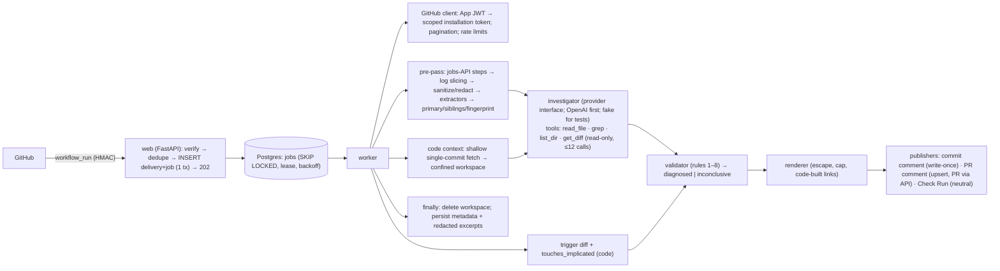

# Architecture and Decisions (canonical)

Version 2.0, 2026-10-18. This supersedes `research/archive/2026-10-15-s1-plan/ARCHITECTURE-DECISIONS.md` and `DECISION-REGISTER.md` (they are kept for history). Evidence IDs (EV-…) are in `research/final-evidence-review/EVIDENCE-LEDGER.md`.

**Basis tags**

| Tag | Meaning |
|---|---|
| **[PLAT]** | Required by GitHub behaviour |
| **[PARITY]** | Required by the approved MVP scope |
| **[GOAL]** | Our own choice |
| **[HYP]** | To be tested |

## 1. System overview

**One deployable:** a single Python package with `web` and `worker` processes, and Postgres. No Redis, object store, TypeScript service or dashboard.

## 2. Decisions

| ADR | Decision | Basis | Supersedes | Alternatives rejected |
|---|---|---|---|---|
| ADR-01 | **Python 3.12+ modular monolith:** FastAPI, httpx, SQLAlchemy 2 + asyncpg, Alembic, Pydantic v2. Implementation language is **Python only**. | [GOAL]; D-2 | — | Node/TS backend; microservices |
| ADR-02 | **GitHub App** (webhooks) as the integration, and a CLI for offline benchmarks. No GitHub Action. **No TypeScript component is required:** App JWT, webhooks and REST are all handled in Python. | [PLAT] EV-P01, EV-P10 (only Apps create Check Runs) | — | Action; CLI-only |
| ADR-03 | **Postgres job table** with `SKIP LOCKED`, lease, backoff and dead letter. Delivery and job are inserted in one transaction. | [PLAT] EV-P05; [GOAL] | — | Redis/arq (dual-write gap) |
| ADR-04 | **No raw log or source persistence.** Logs are streamed and sliced in memory. Code lives in a per-job temp workspace that is deleted in `finally`. | [GOAL] | — | Object store |
| ADR-05 | **Tenant = installation.** App-layer scoping, plus Postgres RLS with transaction-local `set_config` before any external installation. | [GOAL] | — | Schema-per-tenant |
| ADR-06 | **Three publishing surfaces** (Q2): commit comment (write-once; creating needs Contents read, editing would need write), PR comment (upsert; Pull requests write), Check Run (`neutral`; Checks write) | [PLAT] EV-P09, EV-P10; [PARITY] | Old ADR-06 "Check Run only" | Check-Run-only; comment-only |
| ADR-07 | **No dashboard in the MVP.** GitHub surfaces are the UI; admin work is done by CLI. | [GOAL] | — | Next.js dashboard |
| ADR-08 | **AI investigation on by default** after the deterministic pre-pass. **Provider interface, OpenAI first** (Q4). Read-only tools; ≤12 calls; ≤120 s; structured output; 1 repair attempt; then inconclusive. Model chosen by measured evaluation. Offline tests use the fake provider. | [PARITY]; Q1, Q4 | Old ADR-08 "LLM off; adjudicator only"; DR-27, DR-28 | Rules only (can't produce line-level fixes); open-ended agent |
| ADR-09 | **Hosting decided at pilot time.** The S1 candidate was Fly.io + Neon, priced 2026-10-15. Prices must be re-verified then. | [GOAL] | — | — |
| ADR-10 | **Auth:** webhook HMAC (constant-time); App JWT → installation tokens scoped to the repo and permissions; no end-user auth | [PLAT] EV-P07, EV-P17 | — | — |
| ADR-11 | **Billing** is manual for pilots | [GOAL] | — | Paddle/Stripe integration |
| ADR-12 | **Observability:** structlog JSON with correlation IDs; per-analysis usage and cost record; Sentry at pilot | [GOAL] | — | OTel stack |
| ADR-13 | **Attribution is a signal, not proof.** The MVP computes only trigger-diff relevance (code-computed). Lane history, flaky and dependency drift are P2, after benchmark validation. Never "caused by". | [GOAL]; EV-P26 | Old ADR-13 (full rule engine in the MVP) | — |
| ADR-14 | **Code context without checkout** (revised 2026-10-18, T-304): `git init --bare --template=` into a private 0700 workspace; `git fetch --depth=1 --filter=blob:limit=1m origin +<head_sha>:refs/tw/head` from `https://github.com/<owner>/<repo>.git` only. The token goes in an `Authorization` header injected through `GIT_CONFIG_*` env (never argv, URL or config). Files are read with `git cat-file` under `GIT_NO_LAZY_FETCH=1` and no credentials, so nothing is ever checked out: no hooks, filters, LFS smudge, submodules or on-disk symlinks. Symlinks are resolved lexically inside the tree. Contents-API fallback at the same SHA, then an explicit unavailable result. | [PLAT] EV-P16, EV-P17; local git 2.56 + `git http-backend` tests; [HYP] fetch-by-SHA + blob filter on github.com (G-PLAT-9) | Old ADR-14 (fetch + checkout into a workspace) | Checkout with hardening; tarball; API-only |
| ADR-15 | **PR association via API:** same-repo `GET /commits/{sha}/pulls`; fork `GET /pulls?head=owner:branch`; filter to open PRs into this repo with `head.sha == head_sha`. Exactly one match → that PR; none → push; **several → `ambiguous` (no guess; D-4)**; malformed response → `error`. The payload `pull_requests` is never read. | [PLAT] EV-P23, EV-P24 | Old plan `pr_numbers` from the payload; the 2026-10-18 "lowest number" tie-break (no basis in the spec) | — |
| ADR-16 | **Credentials policy:** only project-scoped App credentials (provisioned by you for live tests). No personal, global or CLI GitHub credentials anywhere: service, tests, benchmark. The OpenAI key comes from local env, is never committed or logged, and is not required offline. | [GOAL]; user rule | Old RESOURCE R3 / T0.01 | PAT-based lab tooling |
| ADR-17 | **Spoofing resistance:** failed step from the jobs API. Printed markers and versions never drive attribution alone. | [GOAL] | — | Log-text-only step detection |
| ADR-18 | **Evidence validation is separate from causation:** the validator proves citations exist. Causal fields are code-computed. `high` confidence needs deterministic corroboration. | [GOAL] | — | Trusting model self-reported confidence |

## 3. Data model (MVP)

The tenant key is `installation_id`. Every tenant table has a row-level security policy on it (T-705, §4.7).

| Table | Key columns | Notes |
|---|---|---|
| `installation` | `id` (GitHub id) PK, `account_login`, `status`, `deleted_at`, `purge_after`, `monthly_quota` | System table |
| `repository` | `id` PK, `installation_id` FK, `full_name`, `default_branch`, `enabled`, `removed_at` | — |
| `webhook_delivery` | `delivery_id` PK, `event`, `action`, `installation_id`, `received_at`, `outcome` | System; retained 14 days |
| `job` | `id`, `kind`, `installation_id`, `run_key`, `dedupe_key` UNIQUE, `payload` JSONB (IDs only), `status`, `attempts`, `max_attempts`, `run_after`, `deadline_at`, `locked_by`, `locked_until`, `last_error` (redacted, ≤500), `result` | States: `queued` → `running` → `succeeded`; `running` → `retry_wait` → `running`; `running` → `dead`; `queued`/`retry_wait` → `cancelled`. Transitions out of `running` require lease ownership. Deadline: 10 min from the first claim. |
| `workflow_run` | `id`, `installation_id`, `repo_id`, `github_run_id`, `run_attempt`, `workflow_id`, `head_sha`, `head_branch`, `head_repo_id`, `event`, `conclusion` | UNIQUE (repo, run, attempt) |
| `analysis` | `id`, `installation_id`, `run_pk` UNIQUE, `status`, `category`, `confidence_band`, `diagnosis` JSONB (SPEC §3.1), `provider`, `model`, `tokens_in`, `tokens_out`, `cost_usd`, `latency_ms` | Retained 180 days |
| `publication` | `id`, `analysis_id`, `surface` (commit_comment / pr_comment / check_run), `github_id`, `target_key` (repo:sha:workflow, repo:pr:workflow or repo:run), `state`, `last_error` | UNIQUE (`surface`, `target_key`). A DB trigger makes a published commit comment write-once; PR comments and Check Runs are upserted. |
| `failure_signature` | `repo_id`, `fingerprint` UNIQUE per repo, `normalized_message` (≤300 chars, redacted), `first_seen_run`, `last_seen_run`, `occurrences` | Retained 365 days |
| `usage_event` | `installation_id`, `analysis_id`, `kind`, `quantity` | Quota and cost |
| `audit_event` | `installation_id`, `actor`, `action`, `detail` | Retained 1 year, content-free |

## 4. Security boundaries

| Boundary | Control |
|---|---|
| Untrusted input → system | HMAC; size caps; spoof-resistant step detection |
| Untrusted content → model | Delimited data; read-only tools; schema output |
| Model → user-visible output | Validator; escaping; code-built links |
| Workspace → host | No checkout: objects only, read via `git cat-file`; tree-path confinement; no hooks, filters, LFS or submodules; no execution; size, time and count limits; cleanup in `finally` plus a startup sweep (§4.2) |
| Tenant → tenant | Scoped tokens; RLS |
| Secrets | Redaction before storage or LLM; the key comes from env |
| Service → GitHub (T-301, T-302) | See §4.1 |

### 4.1 GitHub credentials and calls

| Control | Implementation |
|---|---|
| App JWT | RS256; `iat` −60 s; lifetime 9 min. The key is loaded from a file path and held only as a parsed key object; `repr` hides it. |
| Installation tokens | Minted **per repository and per purpose**: the `analysis` scope is Actions, Contents and Metadata read; the `publish` scope is Contents and Metadata read, plus Pull requests and Checks write. Each token sends `repository_ids=[repo]`. |
| Token checks | The grant is checked against the request; any extra permission, a non-`selected` repository selection or a different repository set fails closed. |
| Token storage | Cached in memory only, keyed by (installation, repo, scope), dropped 5 min before expiry, and registered with the log scrubber while alive. |
| Endpoint registry | `github/endpoints.py` lists every callable endpoint and the one permission that authorises it. The client cannot call anything else. A test checks the list statically against FS-INS-2 (AT-SEC-01). Only `github/client.py` may import an HTTP library or name the API host. |
| Scope enforcement | A `RepoClient` refuses, before minting or sending anything, any endpoint whose permission is outside its token scope (e.g. the analysis client cannot comment; the publish client cannot read logs). |
| Repository binding | A `RepoClient` is bound to one repository; `owner`/`repo` cannot be overridden. The contents path rejects `..`, absolute paths and backslashes. |
| Errors and retries | Rate limits: `retry-after`, then `x-ratelimit-reset`, otherwise ≥60 s (doubling). Waits ≤10 s happen inline; longer ones go back to the queue with `retry_after_s`. 5xx and transport errors: ≤3 inline retries with backoff. 401: re-mint once. Other 403s: `PermissionDenied`, naming the permission when GitHub sends `x-accepted-github-permissions`. 404, 410 and 422 are permanent. |
| Log download | A 302 is followed only to an `https` URL without credentials whose host is on the allowlist. The request carries **no** `Authorization` header and follows no further redirects. Streamed and capped at 512 MB. |
| Response bounds | JSON ≤10 MB; pagination only to the API host, ≤20 pages |

See [SPEC.md](SPEC.md) FS-SEC-*, and [ACCEPTANCE-TESTS.md](ACCEPTANCE-TESTS.md) §9.

### 4.2 Code context (T-304)

| Control | Implementation |
|---|---|
| Inputs | Owner/repo (GitHub name rules) and the commit (40-hex) are validated before any process starts. The host is fixed to `https://github.com`; tests can use `http://127.0.0.1` only through an explicit loopback flag that production never sets. |
| Process | A fixed `git` binary, no shell. An env built from scratch (no inherited `GIT_TRACE*`, `GIT_CURL_VERBOSE`, proxies, HOME or global/system config). Prompts and credential helpers are off; `protocol.allow=never` except the one scheme; `http.followRedirects=false`; a new process group. |
| Limits | Fetch ≤60 s; each read ≤10 s; workspace ≤256 MB, checked during the transfer **and once after it ends**; blob filter 1 MB; read output capped; ≤100k tree entries; per-analysis read budget (24 MB, 4000 reads). On a breach the process group is SIGKILLed. |
| Paths | Repo-relative, NFC, no control or format characters, no `..`, `.`, empty or `.git` segments, no backslashes, ≤1024 bytes. Percent signs stay literal. |
| Outcomes | Files that are oversized (including blobs filtered on the server), binary, symlinks escaping the tree, symlink loops or submodules are recorded in `skipped` (FS-CTX-1 `files_skipped`) and never trigger broader access. |
| Fallback | The Contents API at `ref=<head_sha>`. Each file's blob SHA must equal the tree entry's, and its size must match. Oversized files are never requested. Symlink targets come from `git/blobs`. If both paths fail: `UnavailableSource`. |
| Tools (T-305) | Only `read_file`, `grep`, `list_dir` and `get_diff` exist; there is no write, execute, network or patch tool. ≤12 calls; output ≤8000 chars per call; `read_file` ≤250 lines. `files_examined` comes only from successful `read_file` calls. `list_dir` accepts only `""`/`"."` as the root (`"/"` is refused). |
| `grep` isolation | Model-supplied regexes run in a separate `python -I -m tracewise.context.grep_worker` process with an empty environment, `cwd=/`, CPU ≤5 s and address space ≤768 MB rlimits, and a parent timeout of 5 s. It receives only the text to search (≤400 files, ≤8 MB); it has no file or network access by design, though this is not sandboxed by the OS. Symlinks and submodules are not grep targets. |
| Trigger diff (T-306) | The compare API with validated SHAs: `parent...head` for a push, `base...head` (merge base) for a PR. Truncated at ≥300 files or >250 commits. Filenames from the API pass the same path rules. `touches_implicated` is code-only and three-valued. An unknown diff, a truncated diff with no overlap, or **no implicated paths** gives `null`, never `false`. Callers must pass the pre-pass paths **and** the validated diagnosis location. No statement uses causal wording. |
| **Residual risk** | While a fetch runs, the token sits in the environment of the `git`/`git-remote-http` child processes and can be read by the **same OS user** through `/proc/<pid>/environ`. Mitigation: run the worker as a dedicated user with no other workloads; the token is repo-scoped, read-only and short-lived. |

### 4.3 Investigation, validation and report (T-401…T-404, T-501)

| Control | Implementation |
|---|---|
| Boundary | `collect_evidence()` ends retrieval. `diagnose()` runs inside that block and reasons only over the bundle plus the read-only `ToolBox`. The provider never touches tools, files, network or credentials; the loop dispatches every call. |
| Provider seam | `investigate/provider.py`: `Provider.step(StepRequest) → StepResponse` (tool calls or final text). Offline: `ScriptedProvider`. No SDK or network dependency (OpenAI adapter: D-7). |
| Budgets (code-enforced) | ≤12 tool calls (a batch that would exceed is refused whole), ≤120 s wall clock, 200k tokens, 16 iterations, 1 KB of arguments per call, 3 consecutive unproductive steps, 16k-char final answer. Duplicate calls are not re-executed but still count. One repair turn without tools; then `invalid_output`. |
| Untrusted data | System policy is fixed code. Logs, commands and tool output sit in `<<UNTRUSTED nonce …>>` blocks; delimiter-like sequences inside are neutralised. |
| Model output | Strict schema (`investigate/schema.py`): category, root cause, why, location, text-only fix, ≤3 next steps, verdicts. Attribution, confidence, files_examined, primary_errors and status are dropped if present (rule 5, ADR-18). |
| Validation | SPEC §3.2 rules 1–8 plus D-6 hardening; fail closed to `inconclusive` with a fixed reason code. The snippet is copied by code (FS-DX-4). Attribution uses pre-pass paths **plus** the validated location; with no validated diagnosis it is "unknown", never "not implicated". |
| Confidence | D-5, code-only (`investigate/confidence.py`). |
| Immutability | `ValidatedDiagnosis` = frozen model + SHA-256 of its canonical JSON. `render()` refuses on mismatch, including in-place list mutation. |
| Report | `report/render.py`: deterministic; observed facts are labelled separately from the assessment. Prose escaped (HTML, Markdown, @mentions, #refs); code spans literal; fences longer than any inner backtick run. Links only from IDs. Fix shown as text, never applied. Whole low-priority sections dropped to fit the 60k cap; a final redaction pass. |
| **Open** | AT-SEC-08 depends on model behaviour: the code guarantees no injected command reaches a fix and no unread location is accepted, but a steered model can still name a file it read. That is measured with a real model in T-605. |

### 4.4 Publication and the worker (T-502, T-503)

| Topic | Implementation |
|---|---|
| Flow | `jobs/handlers/analyze.py`, registered as `analyze`: validate payload, then installation/repository scope in the DB → `collect_evidence` → PR association → `diagnose` → persist `analysis` → `render` → publish → result. No GitHub write happens before the scope check. |
| Identity | Commit comment `repo:sha:workflow` (write-once; DB trigger); PR comment `repo:pr<N>:workflow`, hidden marker `<!-- tracewise:pr:wf<id> -->` plus our App as author; Check Run `repo:run_id` with `external_id=run_id`, name `Tracewise`, **always `neutral`**. |
| Idempotency | The publication row is locked (`FOR UPDATE`) for the whole external call, so concurrent publishers serialise. Unchanged content is skipped; an older `(run_id, attempt)` never overwrites a newer one (`stale`). **Reconcile before create**: list commit comments, PR comments or check runs and adopt our own object (marker + App id, or `external_id`). |
| Client rule | **POST is never retried inline** (it may have been applied without a response). The job retries instead, and reconciliation runs first. GET and PATCH keep inline retries. |
| Remaining window (not exactly-once) | Within one database, duplicates are prevented by the row lock plus reconciliation. A duplicate is still possible if something outside this database creates our marker or `external_id` object between reconciliation and our POST, or if GitHub's list endpoints lag behind a just-accepted write (read-after-write consistency is not documented). |
| Failures | Provider timeout/failure: retry ≤2, then "could not complete" (Check Run + PR comment; no commit comment). Logs 404/410, or a read 403: metadata or missing-permission notice, no retry. 403 on a surface: `unpublished_permission` plus the permission recorded; the Check Run names it; other surfaces continue. Transient GitHub/DB errors: retry with backoff (honouring `retry-after`; 10-min deadline). Unexpected exceptions: retry, then `dead`; a best-effort could-not-complete notice on the last attempt; never reported as success. Lease lost: no further writes. D-8, D-9. |
| Connection use | A publication holds one pool connection during its GitHub call (bounded by client timeouts). Pool size must exceed the worker concurrency. |

### 4.5 Installation lifecycle (T-701)

| Event | Effect (one transaction with the delivery row; duplicates are no-ops) |
|---|---|
| `installation.created` / `unsuspend` | Installation `active` (unless `deleted`: no resurrection); payload repositories granted |
| `installation.suspend` | `suspended`; queued/retry_wait jobs → `cancelled` (`installation_suspended`) |
| `installation.deleted` | `deleted`, `deleted_at`, `purge_after = +7 days` (purge itself is T-704); pending jobs → `cancelled` (`cancelled_uninstalled`) |
| `installation_repositories.added` | `removed_at` cleared (the Tracewise `enabled` toggle is kept) |
| `installation_repositories.removed` | `removed_at` set, only for repositories owned by this installation; their pending jobs → `cancelled` (`repo_not_in_scope`) |
| `workflow_run` failure | Refused at ingestion with `installation_inactive`, `repo_not_in_scope` or `repo_disabled` (AT-INS-04); no job |
| Running job | Scope re-checked after investigation and before persisting or publishing → `cancelled` with the reason; a refused token mint → `cancelled_uninstalled`. No GitHub write happens for any of these. |

Validation: lifecycle payloads are HMAC-verified and schema-validated (ids > 0, `owner/repo` names). Invalid payloads → 400, recorded as `rejected`, no state change. Historical analyses and publications are kept (purge is T-704).

### 4.6 Recovery (T-702)

| Pass | Behaviour |
|---|---|
| (a) Redelivery | `GET /app/hook/deliveries?status=failure` (App JWT; cursor pagination; ≤`max_pages`×100 items). Kept: newer than `max(now−72h, high_water−10m)`, grouped by GUID. Redelivered (`POST …/attempts`, the latest attempt id) only if we never recorded that GUID, no attempt succeeded, the event is handled, the installation is not inactive (lifecycle events always pass), fewer than 3 attempts and ≥15 min since the last. Each request is recorded in `redelivery_request`; at most `max_requests` per pass. The high-water mark advances only after a complete pass. |
| (b) Failed-run sweep | Round-robin over enabled, in-scope repositories of active installations from a durable cursor (`sweep:repo_cursor`, advanced per finished repository). `GET /repos/{o}/{r}/actions/runs?status=failure|timed_out&created>=now−24h` with the repository's analysis token. A run is accepted only if GitHub attributes it to that repository, and is then fed through `ingest_workflow_run` (delivery id `sweep-{repo}-{run}-{attempt}`), so run dedupe and T-701 scope apply exactly as for webhooks. |
| Already covered elsewhere | Delivery without a job: impossible, since delivery, run and job are one transaction (T-106). Vanished worker, expired lease, retry not executed: queue reaper and `run_after` (T-105). Failed GitHub calls: job retries (T-302/T-503). Disabled or removed scope: T-701. |
| Stops | A rate limit stops the pass with `completed=false`; checkpoints keep progress. A refused token for one repository is counted and the sweep moves on. |
| Entry point | `python -m tracewise.recovery {deliveries|runs|both}`: one bounded pass, JSON summary, non-zero exit if incomplete. Needs the project App and database configuration; **no schedule is configured**. |

### 4.7 Row-level security and database roles (T-705)

| Item | Behaviour |
|---|---|
| Policies | Migration 0005 enables RLS on the 10 tables that carry an installation: `installation` (by `id`), `repository`, `workflow_run`, `job`, `analysis`, `publication`, `failure_signature`, `usage_event`, `audit_event`, `webhook_delivery`. Each has one policy, `tenant_isolation`, applied to reads and writes: `installation_id = tracewise_tenant()`. |
| Context | `tracewise_tenant()` reads `current_setting('tracewise.installation_id', true)`. `transaction(pool, tenant=id)` sets it with `set_config(..., true)`, so it is **transaction-local**: it is gone after COMMIT or ROLLBACK, and a pooled connection never carries it into the next transaction. If it is missing or empty, nothing is visible and every insert fails. A malformed value is an error. Non-positive or non-integer ids are rejected in Python. |
| Tenant plane: `tracewise_app` (`DATABASE_URL`) | The analyze handler (`_load`, `_recheck`, `_persist`) and the `Publisher` use it, always with the job's installation. It is not the table owner, has no BYPASSRLS, and keeps the privileges from 0001 (no DELETE on content, no UPDATE or DELETE on `audit_event`). 0005 revokes its access to `recovery_checkpoint` and `redelivery_request`. |
| System plane: `tracewise_system` (`DATABASE_URL_SYSTEM`) | Webhook ingress, lifecycle handling, the queue and worker bookkeeping, and recovery. These run before a tenant is known, or act across tenants. The role has BYPASSRLS and the same table privileges as the app role had before 0005 (no DELETE on content; `audit_event` is append-only). It is not a superuser and not the owner. |
| Owner `tracewise_owner` | Runs migrations only. It owns the tables, so RLS does not apply to it. No `FORCE ROW LEVEL SECURITY` is set, because no runtime path uses the owner. |
| What RLS protects | A tenant-plane query that forgets its `installation_id` filter, or uses a payload id belonging to another tenant, sees and writes nothing outside the job's installation (AT-SEC-03). This is defence in depth beneath the application checks (D-9) and the token scoping. |
| What it does not protect | Code running as `tracewise_app` can set any tenant id itself; RLS is not a barrier against arbitrary SQL execution in the service. Unique constraints still reveal that a key exists in another tenant (for example, an INSERT conflict); all such keys include tenant-specific GitHub ids. The system plane bypasses RLS by design. |
| Guards (security audit 2026-10-19) | Migration 0006 revokes write access to `alembic_version` from both runtime roles. `require_tenant_plane()` runs when the analyze handler is built and fails closed on a role that is not subject to RLS. `tests/db/test_db_security.py` fails if a table carrying an installation has no RLS policy, or if a new table is not declared. |
| Provisioning (review item) | `tracewise_system` must exist (LOGIN BYPASSRLS, created by an administrator) **before** migration 0005 runs, or 0005 grants it nothing. Tables added after 0005 must grant the system role explicitly. Deployment provisioning is not done (no deployment in this phase). |

### 4.8 Observability (T-706)

| Item | Behaviour |
|---|---|
| Events | `tracewise.observe.event(log, name, **fields)` writes one JSON log line carrying `event` (a stable dotted name), the fields, and the correlation ids bound with `bind()`: `delivery_id`, `job_id`, `installation_id`, `repo_id`, `run_id`, `attempt`. This uses stdlib `logging` with the existing `JsonFormatter`; no new dependency (ADR-12 named structlog; the existing formatter already provides the same JSON lines). |
| Field safety | Fields must be scalars, short lists, or flat dicts of scalars. A field is dropped if any word of its name names credentials or content: `token`, `secret`, `authorization`, `url`, `body`, `payload`, `source`, `patch`, `diff`, `message`, `text`, `jwt`, and others. Strings are capped at 200 characters. The `SecretFilter` additionally scrubs token shapes, registered secrets, URL credentials and **every URL query string**. `configure()` sets `httpx`, `httpcore` and `urllib3` to WARNING, because their INFO lines print full request URLs, including signed log redirects (security audit SA-4). |
| Never breaks processing | `event()` never raises. A fault is counted in `observe.dropped_events`. If the per-analysis record cannot be written after publication, the failure is reported (`analysis.ops_record_failed`) and not raised, so publication is never repeated. |
| Per-analysis record (AT-OPS-01) | `analysis.status` (outcome), `tokens_in` and `tokens_out`, `latency_ms` (model time), `cost_usd`, plus `stage_ms` (`collect`, `associate`, `diagnose`, `persist`, `publish`, `total`), `publish_result` ({surface: state}) and `finished_at`. Migration 0007 adds the last three. **Cost** is computed only from configured prices (`LLM_PRICE_INPUT_PER_MTOK`, `LLM_PRICE_OUTPUT_PER_MTOK`); otherwise it stays NULL and the report counts it as `unpriced`. Prices are a T-605 output. |
| Report and alert (FS-OPS-1, FS-OPS-2) | `python -m tracewise.ops report` gives outcomes, job states, retries, end-to-end p50/p95 (job created → finished; target ≤ 600 s), processing and model time, tokens, cost and publication states, all with sample sizes and `null` when there is no data. `python -m tracewise.ops alerts` computes the failure rate: (dead + `could_not_complete`) / (succeeded + dead) over 1 h. Cancelled no-ops are excluded. The provisional threshold is 0.2, with at least 10 jobs. When it fires it logs `alert.failure_rate` and exits 2. The report gives aggregates only, via the system plane. **Nothing is scheduled and no alert is routed anywhere** (deployment, T-1002). |

Event catalogue:

| Area | Events |
|---|---|
| Webhook | `webhook.ingested` (`outcome`: enqueued, duplicate_delivery, duplicate_run, ignored, repo_not_in_scope, repo_disabled, installation_inactive), `webhook.recorded`, `webhook.lifecycle`, `webhook.payload_rejected`, `webhook.signature_rejected`, `webhook.bad_headers`, `webhook.too_large`, `webhook.not_configured`, `webhook.db_unavailable`, `webhook.ping` |
| Queue and worker | `job.claimed`, `job.succeeded`, `job.retry_scheduled`, `job.failed` (dead), `job.cancelled` (`reason`), `job.lease_lost`, `job.completion_ignored`, `job.record_failed`, `job.processed`, `queue.lease_expired`, `worker.db_unavailable` |
| Analysis | `analysis.started`, `analysis.diagnosed` (status, category, band, `abstained`, `inconclusive_reason`, validation flags, tokens, tool calls), `analysis.finished` (outcome, `stage_ms`, publications), `analysis.ops_record_failed`, `analysis.notice_failed` |
| Publication | `publication.result` (surface, state), `publication.permission_refused` |
| Recovery | `recovery.redelivery_requested`, `recovery.run_ingested`, `recovery.pass_finished` |
| Alert | `alert.failure_rate` |

### 4.9 Retention and purge (T-704)

| Item | Behaviour |
|---|---|
| Mechanism | `tracewise_purge(batch_limit)`, a SECURITY DEFINER function from migration 0008 with a fixed `search_path`. Only `tracewise_system` may EXECUTE it; the system role still has no DELETE on content. It takes no date input, and its cut-offs use the database clock. Each step deletes at most `batch_limit` rows (clamped to 1..10000). One call is one transaction. An advisory try-lock makes a concurrent call return `locked`. |
| Policy | 90-day excerpts (diagnosis document), 180-day analyses with their publications, 14-day deliveries, and 365 days for fingerprints, runs (once unreferenced), terminal jobs, usage, audit and redelivery bookkeeping. Non-terminal jobs are never deleted. Interpretations are in D-12. |
| Tenant purge (FS-INS-3) | Applies to a `deleted` installation past `purge_after` (+7 days) with no queued, running or retry_wait job. All of its tenant rows are deleted, bounded per call and resumable. Then `purged_at` is set, `account_login` is cleared, and a `tenant_purged` audit event is written. A tombstone row remains, so late lifecycle events stay no-ops. A `deleted` row without `purge_after` is reported, not purged. |
| Driver | `python -m tracewise.retention [--batch-limit N] [--max-batches M]` runs on the system role. Exit codes: 0 when everything due was handled, 3 when unfinished (run again), 1 on error. It logs `retention.batch`, `retention.finished` and `retention.failed`. **No schedule is installed.** |
| Deduplication | Run deduplication (unique repo, run and attempt in `workflow_run`, 365 days) outlives delivery deduplication (14 days). A delivery GUID that reappears after 14 days is therefore `duplicate_run` and creates no new job. The recovery window (72 h) is far shorter than both. |

## 5. Open architectural items

| ID | Item | Resolved by |
|---|---|---|
| G-PLAT-1…7 | Live platform behaviours (startup_failure, re-run delivery, output limits, forks, commit comment with Contents read, uninstall, declined permissions) | LIVE tests after you approve a test org |
| G-PLAT-12 | Recovery assumptions verified only against fakes: the delivery list honours `status=failure` and cursor links; a redelivery reuses the original GUID as `X-GitHub-Delivery`; the runs list honours `status` plus `created`. | LIVE (T-801…T-803) |
| G-PLAT-11 | **Publish-token scope bundling.** The `publish` token requests Pull requests write **and** Checks write together. If an installation declined one permission, GitHub may refuse the whole mint (422), which would block the Check Run as well and contradict AT-REL-05's intent (Check Run published, naming the missing permission). Offline tests simulate a 403 on the write, not a mint refusal. A fix would mint one token per surface. | LIVE (G-PLAT-7), then a design change for review |
| G-PLAT-10 | Publication reconciliation relies on `performed_via_github_app.id` (comments) and `app.id` / `external_id` (check runs) in GitHub's list responses, and on those lists reflecting a just-accepted write. Verified only against the fake API. | LIVE (T-801…T-803) |
| G-PLAT-9 | github.com accepting `fetch --depth=1 --filter=blob:limit=1m <sha>` with an installation token in a Basic header (verified only against local `git http-backend`) | LIVE (T-801…T-803) |
| G-PLAT-8 | **Log-redirect host allowlist** (`*.actions.githubusercontent.com`, `*.blob.core.windows.net`) is an assumption: GitHub documents the 302 but not its host. If the real host differs, logs fail closed (`UnsafeRedirect`). It also needs checking that the token grant response echoes `repositories`. | LIVE (T-801…T-803) |
| UD-2 | Shallow fetch vs contents API in practice (size, latency) | T-304 measurement |
| UD-3 | OpenAI model choice | T-605 measured evaluation |
