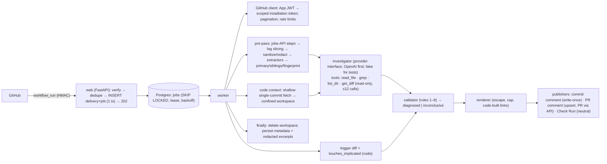

# Architecture and Decisions (canonical)

Version 2.0, 2026-10-18. This supersedes `research/archive/2026-10-15-s1-plan/ARCHITECTURE-DECISIONS.md` and `DECISION-REGISTER.md` (they are kept for history). Evidence IDs (EV-…) are in `research/final-evidence-review/EVIDENCE-LEDGER.md`.

**Basis tags**

| Tag | Meaning |
|---|---|
| **[PLAT]** | Required by GitHub behaviour |
| **[PARITY]** | Required by the approved MVP scope |
| **[GOAL]** | Our own choice |
| **[HYP]** | To be tested |

## 1. System overview

**One deployable:** a single Python package with `web` and `worker` processes, and Postgres. No Redis, object store, TypeScript service or dashboard.

## 2. Decisions

| ADR | Decision | Basis | Supersedes | Alternatives rejected |
|---|---|---|---|---|
| ADR-01 | **Python 3.12+ modular monolith:** FastAPI, httpx, SQLAlchemy 2 + asyncpg, Alembic, Pydantic v2. Implementation language is **Python only**. | [GOAL]; D-2 | — | Node/TS backend; microservices |
| ADR-02 | **GitHub App** (webhooks) as the integration, and a CLI for offline benchmarks. No GitHub Action. **No TypeScript component is required:** App JWT, webhooks and REST are all handled in Python. | [PLAT] EV-P01, EV-P10 (only Apps create Check Runs) | — | Action; CLI-only |
| ADR-03 | **Postgres job table** with `SKIP LOCKED`, lease, backoff and dead letter. Delivery and job are inserted in one transaction. | [PLAT] EV-P05; [GOAL] | — | Redis/arq (dual-write gap) |
| ADR-04 | **No raw log or source persistence.** Logs are streamed and sliced in memory. Code lives in a per-job temp workspace that is deleted in `finally`. | [GOAL] | — | Object store |
| ADR-05 | **Tenant = installation.** App-layer scoping, plus Postgres RLS with transaction-local `set_config` before any external installation. | [GOAL] | — | Schema-per-tenant |
| ADR-06 | **Three publishing surfaces** (Q2): commit comment (write-once; creating needs Contents read, editing would need write), PR comment (upsert; Pull requests write), Check Run (`neutral`; Checks write) | [PLAT] EV-P09, EV-P10; [PARITY] | Old ADR-06 "Check Run only" | Check-Run-only; comment-only |
| ADR-07 | **No dashboard in the MVP.** GitHub surfaces are the UI; admin work is done by CLI. | [GOAL] | — | Next.js dashboard |
| ADR-08 | **AI investigation on by default** after the deterministic pre-pass. **Provider interface, OpenAI first** (Q4). Read-only tools; ≤12 calls; ≤120 s; structured output; 1 repair attempt; then inconclusive. Model chosen by measured evaluation. Offline tests use the fake provider. | [PARITY]; Q1, Q4 | Old ADR-08 "LLM off; adjudicator only"; DR-27, DR-28 | Rules only (can't produce line-level fixes); open-ended agent |
| ADR-09 | **Hosting decided at pilot time.** The S1 candidate was Fly.io + Neon, priced 2026-10-15. Prices must be re-verified then. | [GOAL] | — | — |
| ADR-10 | **Auth:** webhook HMAC (constant-time); App JWT → installation tokens scoped to the repo and permissions; no end-user auth | [PLAT] EV-P07, EV-P17 | — | — |
| ADR-11 | **Billing** is manual for pilots | [GOAL] | — | Paddle/Stripe integration |
| ADR-12 | **Observability:** structlog JSON with correlation IDs; per-analysis usage and cost record; Sentry at pilot | [GOAL] | — | OTel stack |
| ADR-13 | **Attribution is a signal, not proof.** The MVP computes only trigger-diff relevance (code-computed). Lane history, flaky and dependency drift are P2, after benchmark validation. Never "caused by". | [GOAL]; EV-P26 | Old ADR-13 (full rule engine in the MVP) | — |
| ADR-14 | **Code context without checkout** (revised 2026-10-18, T-304): `git init --bare --template=` into a private 0700 workspace; `git fetch --depth=1 --filter=blob:limit=1m origin +<head_sha>:refs/tw/head` from `https://github.com/<owner>/<repo>.git` only. The token goes in an `Authorization` header injected through `GIT_CONFIG_*` env (never argv, URL or config). Files are read with `git cat-file` under `GIT_NO_LAZY_FETCH=1` and no credentials, so nothing is ever checked out: no hooks, filters, LFS smudge, submodules or on-disk symlinks. Symlinks are resolved lexically inside the tree. Contents-API fallback at the same SHA, then an explicit unavailable result. | [PLAT] EV-P16, EV-P17; local git 2.56 + `git http-backend` tests; [HYP] fetch-by-SHA + blob filter on github.com (G-PLAT-9) | Old ADR-14 (fetch + checkout into a workspace) | Checkout with hardening; tarball; API-only |
| ADR-15 | **PR association via API:** same-repo `GET /commits/{sha}/pulls`; fork `GET /pulls?head=owner:branch`; filter `head.sha == head_sha`. The payload `pull_requests` is a hint only. | [PLAT] EV-P23, EV-P24 | Old plan `pr_numbers` from the payload | — |
| ADR-16 | **Credentials policy:** only project-scoped App credentials (provisioned by you for live tests). No personal, global or CLI GitHub credentials anywhere: service, tests, benchmark. The OpenAI key comes from local env, is never committed or logged, and is not required offline. | [GOAL]; user rule | Old RESOURCE R3 / T0.01 | PAT-based lab tooling |
| ADR-17 | **Spoofing resistance:** failed step from the jobs API. Printed markers and versions never drive attribution alone. | [GOAL] | — | Log-text-only step detection |
| ADR-18 | **Evidence validation is separate from causation:** the validator proves citations exist. Causal fields are code-computed. `high` confidence needs deterministic corroboration. | [GOAL] | — | Trusting model self-reported confidence |

## 3. Data model (MVP)

The tenant key is `installation_id`. RLS is added at pilot hardening (T-705).

| Table | Key columns | Notes |
|---|---|---|
| `installation` | `id` (GitHub id) PK, `account_login`, `status`, `deleted_at`, `purge_after`, `monthly_quota` | System table |
| `repository` | `id` PK, `installation_id` FK, `full_name`, `default_branch`, `enabled`, `removed_at` | — |
| `webhook_delivery` | `delivery_id` PK, `event`, `action`, `installation_id`, `received_at`, `outcome` | System; retained 14 days |
| `job` | `id`, `kind`, `installation_id`, `run_key`, `dedupe_key` UNIQUE, `payload` JSONB (IDs only), `status`, `attempts`, `max_attempts`, `run_after`, `deadline_at`, `locked_by`, `locked_until`, `last_error` (redacted, ≤500), `result` | States: `queued` → `running` → `succeeded`; `running` → `retry_wait` → `running`; `running` → `dead`; `queued`/`retry_wait` → `cancelled`. Transitions out of `running` require lease ownership. Deadline: 10 min from the first claim. |
| `workflow_run` | `id`, `installation_id`, `repo_id`, `github_run_id`, `run_attempt`, `workflow_id`, `head_sha`, `head_branch`, `head_repo_id`, `event`, `conclusion` | UNIQUE (repo, run, attempt) |
| `analysis` | `id`, `installation_id`, `run_pk` UNIQUE, `status`, `category`, `confidence_band`, `diagnosis` JSONB (SPEC §3.1), `provider`, `model`, `tokens_in`, `tokens_out`, `cost_usd`, `latency_ms` | Retained 180 days |
| `publication` | `id`, `analysis_id`, `surface` (commit_comment / pr_comment / check_run), `github_id`, `target_key` (repo:sha:workflow, repo:pr:workflow or repo:run), `state`, `last_error` | UNIQUE (`surface`, `target_key`). A DB trigger makes a published commit comment write-once; PR comments and Check Runs are upserted. |
| `failure_signature` | `repo_id`, `fingerprint` UNIQUE per repo, `normalized_message` (≤300 chars, redacted), `first_seen_run`, `last_seen_run`, `occurrences` | Retained 365 days |
| `usage_event` | `installation_id`, `analysis_id`, `kind`, `quantity` | Quota and cost |
| `audit_event` | `installation_id`, `actor`, `action`, `detail` | Retained 1 year, content-free |

## 4. Security boundaries

| Boundary | Control |
|---|---|
| Untrusted input → system | HMAC; size caps; spoof-resistant step detection |
| Untrusted content → model | Delimited data; read-only tools; schema output |
| Model → user-visible output | Validator; escaping; code-built links |
| Workspace → host | No checkout: objects only, read via `git cat-file`; tree-path confinement; no hooks, filters, LFS or submodules; no execution; size, time and count limits; cleanup in `finally` plus a startup sweep (§4.2) |
| Tenant → tenant | Scoped tokens; RLS |
| Secrets | Redaction before storage or LLM; the key comes from env |
| Service → GitHub (T-301, T-302) | See §4.1 |

### 4.1 GitHub credentials and calls

| Control | Implementation |
|---|---|
| App JWT | RS256; `iat` −60 s; lifetime 9 min. The key is loaded from a file path and held only as a parsed key object; `repr` hides it. |
| Installation tokens | Minted **per repository and per purpose**: the `analysis` scope is Actions, Contents and Metadata read; the `publish` scope is Contents and Metadata read, plus Pull requests and Checks write. Each token sends `repository_ids=[repo]`. |
| Token checks | The grant is checked against the request; any extra permission, a non-`selected` repository selection or a different repository set fails closed. |
| Token storage | Cached in memory only, keyed by (installation, repo, scope), dropped 5 min before expiry, and registered with the log scrubber while alive. |
| Endpoint registry | `github/endpoints.py` lists every callable endpoint and the one permission that authorises it. The client cannot call anything else. A test checks the list statically against FS-INS-2 (AT-SEC-01). Only `github/client.py` may import an HTTP library or name the API host. |
| Scope enforcement | A `RepoClient` refuses, before minting or sending anything, any endpoint whose permission is outside its token scope (e.g. the analysis client cannot comment; the publish client cannot read logs). |
| Repository binding | A `RepoClient` is bound to one repository; `owner`/`repo` cannot be overridden. The contents path rejects `..`, absolute paths and backslashes. |
| Errors and retries | Rate limits: `retry-after`, then `x-ratelimit-reset`, otherwise ≥60 s (doubling). Waits ≤10 s happen inline; longer ones go back to the queue with `retry_after_s`. 5xx and transport errors: ≤3 inline retries with backoff. 401: re-mint once. Other 403s: `PermissionDenied`, naming the permission when GitHub sends `x-accepted-github-permissions`. 404, 410 and 422 are permanent. |
| Log download | A 302 is followed only to an `https` URL without credentials whose host is on the allowlist. The request carries **no** `Authorization` header and follows no further redirects. Streamed and capped at 512 MB. |
| Response bounds | JSON ≤10 MB; pagination only to the API host, ≤20 pages |

See [SPEC.md](SPEC.md) FS-SEC-*, and [ACCEPTANCE-TESTS.md](ACCEPTANCE-TESTS.md) §9.

### 4.2 Code context (T-304)

| Control | Implementation |
|---|---|
| Inputs | Owner/repo (GitHub name rules) and the commit (40-hex) are validated before any process starts. The host is fixed to `https://github.com`; tests can use `http://127.0.0.1` only through an explicit loopback flag that production never sets. |
| Process | A fixed `git` binary, no shell. An env built from scratch (no inherited `GIT_TRACE*`, `GIT_CURL_VERBOSE`, proxies, HOME or global/system config). Prompts and credential helpers are off; `protocol.allow=never` except the one scheme; `http.followRedirects=false`; a new process group. |
| Limits | Fetch ≤60 s; each read ≤10 s; workspace ≤256 MB, checked during the transfer **and once after it ends**; blob filter 1 MB; read output capped; ≤100k tree entries; per-analysis read budget (24 MB, 4000 reads). On a breach the process group is SIGKILLed. |
| Paths | Repo-relative, NFC, no control or format characters, no `..`, `.`, empty or `.git` segments, no backslashes, ≤1024 bytes. Percent signs stay literal. |
| Outcomes | Files that are oversized (including blobs filtered on the server), binary, symlinks escaping the tree, symlink loops or submodules are recorded in `skipped` (FS-CTX-1 `files_skipped`) and never trigger broader access. |
| Fallback | The Contents API at `ref=<head_sha>`. Each file's blob SHA must equal the tree entry's, and its size must match. Oversized files are never requested. Symlink targets come from `git/blobs`. If both paths fail: `UnavailableSource`. |
| **Residual risk** | While a fetch runs, the token sits in the environment of the `git`/`git-remote-http` child processes and can be read by the **same OS user** through `/proc/<pid>/environ`. Mitigation: run the worker as a dedicated user with no other workloads; the token is repo-scoped, read-only and short-lived. |

## 5. Open architectural items

| ID | Item | Resolved by |
|---|---|---|
| G-PLAT-1…7 | Live platform behaviours (startup_failure, re-run delivery, output limits, forks, commit comment with Contents read, uninstall, declined permissions) | LIVE tests after you approve a test org |
| G-PLAT-9 | github.com accepting `fetch --depth=1 --filter=blob:limit=1m <sha>` with an installation token in a Basic header (verified only against local `git http-backend`) | LIVE (T-801…T-803) |
| G-PLAT-8 | **Log-redirect host allowlist** (`*.actions.githubusercontent.com`, `*.blob.core.windows.net`) is an assumption: GitHub documents the 302 but not its host. If the real host differs, logs fail closed (`UnsafeRedirect`). It also needs checking that the token grant response echoes `repositories`. | LIVE (T-801…T-803) |
| UD-2 | Shallow fetch vs contents API in practice (size, latency) | T-304 measurement |
| UD-3 | OpenAI model choice | T-605 measured evaluation |
