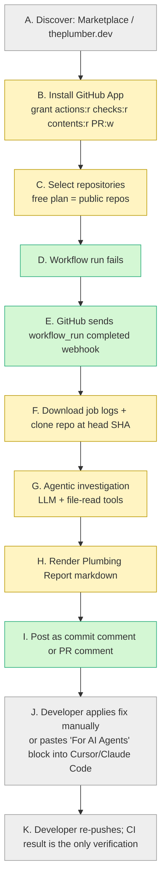

# 01 — Product Teardown: The Plumber (theplumber.dev)

Research date: 2026-10-15. Every claim carries one of these labels:

- **[OBS]**: observed directly by us, through REA, the GitHub REST API or a fetched artifact.
- **[DOC]**: documented or claimed by the vendor.
- **[INF]**: inferred from evidence.
- **[UNK]**: unknown.

Source IDs (S1, S2, …) refer to `08-sources-and-confidence.md`.

---

## 0. Access summary (read this first)

| Surface | Access result | Label |
|---|---|---|
| theplumber.dev (all paths: `/`, `/pricing`, `/docs`, `/examples`, `/privacy`, `/terms`, `/support`, `/robots.txt`, `/sitemap.xml`) | **Blocked.** HTTP 307 → 403 with `cf-mitigated: challenge`, i.e. a Cloudflare Turnstile interstitial. Reproduced with REA headless Chromium (evidence `ev_bd805a79…`), curl, and the in-app browser. The interactive "Verify you are human" checkbox never cleared. We did not attempt to bypass it. | [OBS] |
| api.theplumber.dev/health | Same Cloudflare challenge (via research agent) | [OBS] |
| Wayback Machine | No snapshots of theplumber.dev | [OBS] |
| GitHub App manifest (`api.github.com/apps/the-plumber-app`) | Fully accessible | [OBS] |
| GitHub Marketplace listing | Accessible | [DOC] |
| Public demo repo + bot-authored report | Accessible and verified | [OBS] |
| Installing the app on a test repo | **Not done.** `gh` is unauthenticated in this environment, and installing a third-party GitHub App requires the user's explicit OAuth consent. | — |

**Consequence:** All on-site marketing, docs, privacy and terms content for The Plumber is **[UNK]**. This teardown relies on:

- the app manifest,
- the Marketplace listing,
- and one real, bot-authored Plumbing Report that we read and cross-checked against the repo's git history and Actions run data.

---

## 1. Public product surface

| Item | Finding | Label | Source |
|---|---|---|---|
| Name / tagline | "The Plumber App". Marketplace tagline: "AI-powered CI failure diagnosis…". App description: "Call the plumber when your pipeline breaks!" | [DOC] | S1, S2 |
| Page title (search snippet) | "The Plumber — AI CI Failure Diagnosis" | [DOC] | S3 |
| Distribution | GitHub App only. No GitHub Action (`action.yml`), no CLI, no dashboard. The listing says it needs "no config changes, no CLI, no dashboard". | [OBS] for the absence of an Action in the public org; [DOC] for the rest | S1, S4 |
| App created | 2026-04-14T14:02:31Z; last updated 2026-04-15 | [OBS] | S2 |
| Org created | `theplumber-dev`, 2026-04-14T13:44Z, 1 public repo, 0 followers | [OBS] | S4 |
| Installs | **4** (Marketplace counter) | [DOC] (GitHub-displayed) | S1 |
| Pricing | **Only one plan: Free, $0.** 10 analyses/month, public repositories only, full Plumbing Report, commit and PR comments. **No paid tier is listed.** | [DOC] | S1 |
| Languages claimed | JS, TS, Python, Ruby, PHP, Go, C#, C++, Rust | [DOC] | S1 |
| Privacy claim | Code "never stored… destroyed immediately after the report is posted" | [DOC] | S1 |
| Speed claim | Report "in under two minutes" | [DOC]; **contradicted in the only observable case** (see §3) | S1 |
| Docs / changelog / issue tracker / releases | None public. The docs page (`/examples`) is behind Cloudflare. | [UNK] | — |
| Launch posts, reviews, discussions | None found on PH, HN, Reddit, X, dev.to or IndieHackers | [OBS] (bounded search) | agent search log |
| Team | Appears to be one individual developer; the demo repo is a fork of a personal repo. No legal entity, funding or hiring found. We deliberately did not compile personal details. | [INF] | S4, S5 |

**Not to be confused with** `getplumber/plumber`, an open-source CI/CD *security/compliance scorer* for GitLab CI and GitHub Actions (Show HN, 2026-07-02). It is unrelated to theplumber.dev (S6).

---

## 2. GitHub App permission model [OBS]

From `https://api.github.com/apps/the-plumber-app` (S2), fetched 2026-10-15:

| Permission | Level | What it enables (our reading) |
|---|---|---|
| `actions` | read | List workflow runs and jobs; download job logs |
| `checks` | read | Read check runs and annotations |
| `contents` | read | **Clone the repo at the failing SHA**; read files, commits and diffs |
| `metadata` | read | Mandatory baseline |
| `pull_requests` | write | Post PR comments and reviews |
| **Webhook events** | `workflow_run` only | Triggered when a workflow run completes |

Observations and inferences:

- **[INF]** The report is posted as a **commit comment**, as the demo shows. GitHub's commit-comment endpoint requires `contents: write`, unless the comment goes through the PR scope. Contents is only `read` here, yet a commit comment exists on a commit not linked to any PR. Possible explanations:
  - the manifest permissions were different at install time (the app was updated 2026-04-15, a day after the demo);
  - or the owner-installed app had broader permissions then.

  The exact mechanism is **[UNK]**. This matters for us: to comment on non-PR pushes you need either `contents: write` (commit comments) or `checks: write` (a check-run summary).
- **[INF]** `contents: read` gives access to private repos on any installation that grants them. The free plan's "public repositories only" is therefore a commercial limit, not a technical one.
- **[INF]** There is no `checks: write`, so it does not publish a check run or annotations. The report is comment-only.
- **Least-privilege comparison:**
  - FailBrief needs no `contents` permission at all, because it reads logs only.
  - FixSense requests `contents`, `workflows`, `issues`, `checks` and `pull_requests` all at **write**.
  - The Plumber sits in the middle: read access to code, and write access to PR comments only.

---

## 3. The one observable end-to-end run (verified) [OBS]

The public demo repo `theplumber-dev/coffee_shop` (S5) is a fork of a small Python project with a pytest GitHub Actions workflow.

| Event | Timestamp (UTC) | Source |
|---|---|---|
| Bug introduced: commit `3019c977` "feat: initial coffee shop implementation" adds `pricing.py` with `total = subtotal * TAX_RATE` (line 41) | 2026-04-14 14:21:19 | commit API |
| Upstream repo CI fails on `3019c977` and again on `585de1d2` | 14:24:58 / 14:28:20 | upstream runs API |
| Fork created | 14:40:05 | repo API |
| Commit `b2ef8a12` "Add README…" (**changes only README.md, +3 lines**) | 14:42:43 | commit API |
| Workflow run 24405466283 created → job failed | 14:42:50 → 14:43:01 (run updated 14:43:06) | runs/jobs API |
| `the-plumber-app[bot]` posts a commit comment on `b2ef8a12` | **14:49:20** | comments API |

**Measured latency:** about **6 min 14 s** from the run completing to the report being posted. The vendor claims under two minutes. This is one sample taken on launch day, possibly including cold start or manual triggering, so it is a weak signal, not a benchmark.

### 3.1 Report anatomy ("🪠 Plumbing Report", 2,218 chars)

1. **Summary:**
   - failed step (`pytest --tb=short -v`);
   - root cause (one sentence);
   - **Confidence: High**;
   - **Fix complexity: "Trivial — 1-line change"**.
2. **What Failed:** a fenced excerpt of the failing test line and assertion (`assert 0.21 == 2.71`), plus a summary of the 3 sibling failures.
3. **Why It Failed:** a prose explanation of the mechanism.
4. **Problematic Code:** file path plus line number plus a code snippet.
5. **Recommended Fix:** a replacement line plus a rationale.
6. **Files Examined:** a list of files with the line ranges read and a one-line verdict for each ("correct and not the cause").
7. **For AI Agents:** imperative edit instructions plus a command to run (`pytest tests/test_pricing.py`) "to verify".
8. Footer with a link.

### 3.2 Quality assessment of that report

| Dimension | Assessment |
|---|---|
| Root cause | **Correct.** Line 41 computes only the tax. Diagnosis matches ground truth. |
| Evidence | Good. Quotes the assertion values and connects 0.21 ≈ 8.5% of 2.71 to the tax rate. |
| Fix | Correct and minimal. |
| **Causal-commit attribution** | **Missing.** The triggering commit changed only README.md. The defect came from `3019c977`, and upstream CI had already failed twice before the fork. The report does not say "this commit did not cause the failure" or "the failure has existed since 3019c977". On a real team this is exactly the question that matters ("did *my* push break it?"). |
| Verification | **Not performed.** "Run pytest to verify" is an instruction to the reader. No test run by The Plumber is evidenced. |
| Confidence | Categorical label ("High"), with no stated basis. Correct here, but uncalibrated by construction. |
| Artifacts suggesting implementation | See §3.3 |

### 3.3 Implementation clues visible in the report [INF]

- **Path prefix `coffee_shop/coffee_shop/pricing.py`.**
  - The real path is `coffee_shop/pricing.py`, so the repo name is prepended.
  - This strongly suggests the agent works in a directory *containing* the clone, named after the repo, and that paths are not re-normalized to the repo root.
  - This is consistent with the listing's claim that it "clones the repo at the failing commit".
- **"Files Examined … `order.py` (lines 1-200)".**
  - `order.py` has only 30 lines.
  - A fixed 200-line window suggests a file-reading **tool with a default range**, called by an LLM agent. This is consistent with the listing's "agentic analysis".
- **"Files Examined" with per-file verdicts.** This suggests a multi-step tool loop that records which files it opened and rules some out.
- **Small grammar slip ("lines 41").** Suggests the text is produced by a template plus LLM fields, with the fields filled by the model. Weak signal.
- **Free-tier limit of 10 analyses/month** plus per-analysis clone and agent loop. This suggests a meaningful per-analysis cost: an LLM agent with several tool calls. **[INF, weak]**

---

## 4. User journeys A–K

What was observed versus documented versus unknown:

Legend: green = observed in the demo; yellow = documented on the Marketplace listing or manifest; grey = unknown or inferred.

| Stage | User action | System response | Inputs → outputs | Permissions/config | Timing | Errors/recovery | Data retained | Label |
|---|---|---|---|---|---|---|---|---|
| A Discover | Finds the Marketplace listing (4 installs) | — | — | — | — | — | — | [DOC] |
| B Install | Clicks Install; chooses account | GitHub OAuth install screen | — | 5 permissions listed above | — | — | Installation ID stored by vendor [INF] | [OBS] manifest |
| C Repo selection | All or selected repos | — | — | Free plan: public repos | — | Private-repo behavior on free plan [UNK] | — | [DOC] |
| D Failure | Push triggers a CI failure | — | — | No config changes needed | — | — | — | [OBS] |
| E Receive event | — | `workflow_run` webhook (completed, conclusion=failure) | Webhook JSON → job | Webhook secret [INF] | — | Dedupe/retry behavior [UNK] | — | [OBS] events list |
| F Fetch | — | Logs via Actions API; clone at SHA | run_id → logs + checkout | actions:r, contents:r | Part of the 6m14s | Log-expiry/large-log behavior [UNK] | "Code never stored… destroyed immediately" | [DOC] |
| G Investigate | — | LLM agent reads files | logs + files → hypotheses | — | — | Ambiguous-case behavior [UNK] | — | [INF] |
| H Report | — | Markdown report, 7 sections | diagnosis → markdown | — | — | — | — | [OBS] |
| I Deliver | — | Commit comment (demo); PR comment (claimed) | → GitHub comment | pull_requests:w | 6m14s after run end in demo | Comment dedupe on re-runs [UNK] | Comment persists in GitHub | [OBS]/[DOC] |
| J Fix | Dev applies the one-line fix or pastes the agent block | — | — | — | — | — | — | [UNK] |
| K Verify | Dev re-pushes; CI re-runs | The Plumber is silent on success [INF] | — | — | — | No "fix verified" signal seen | — | [UNK] |

**Not observable:**

- the onboarding UI;
- any loading or progress states (there is no dashboard and no in-progress comment was seen);
- error states;
- quota-exhausted behavior;
- uninstall and deletion flow.

---

## 5. Failure-scenario coverage

| Scenario | Status | Notes |
|---|---|---|
| Compilation / build failure | Unknown / not tested | Generic claim of "CI failure diagnosis" |
| Unit-test assertion failure | **Observed in an accessible demonstration** | coffee_shop pytest case, correct diagnosis |
| Flaky test | Unknown / not tested | No history store is evident (no dashboard) [INF] |
| Dependency-resolution failure | Unknown / not tested | |
| Missing environment variable / secret | Unknown / not tested | |
| Container startup failure | Unknown / not tested | |
| Network timeout / external service | Unknown / not tested | |
| Lint / type-check failure | Unknown / not tested | |
| Failure caused by a recent code change | **Observed, partially**: diagnosed the code defect but **did not attribute it to the introducing commit**, and reported on a README-only commit without flagging that | Single sample |
| Multiple independent failures in one workflow | Unknown | The demo had 4 failures with one shared cause; it grouped them correctly |
| Incomplete / inaccessible logs | Unknown | |
| Ambiguous failure, insufficient evidence | Unknown | No evidence of an abstention mode; the report schema has a confidence field |
| Repeated failure seen before | Unknown | No history feature documented |
| Proposed fix does not resolve the problem | Unknown | No verification loop documented |

---

## 6. Feature inventory

| Feature | Status |
|---|---|
| Automatic trigger on failed `workflow_run` | [OBS] |
| Log retrieval | [DOC] |
| Repo clone at failing SHA plus agentic code reading | [DOC] + [INF] from report artifacts |
| Structured markdown report (summary, root cause, confidence, complexity, snippet, fix, files examined, AI-agent block) | [OBS] |
| Commit comment / PR comment | [OBS] / [DOC] |
| "For AI Agents" handoff block | [OBS]. A distinctive idea: it targets developers who will paste the result into Cursor or Claude Code. |
| Dashboard, history, flakiness, analytics | Not found |
| Fix PR creation | Not found (no `contents: write`) |
| Automated verification | Not found |
| Slack / other destinations | Not found |
| Paid plans, private repos | Not found |
| Self-hosting / BYO key | Not found |
| Other CI platforms (GitLab, etc.) | Not found |

---

## 7. Limitations and unknowns

1. **Website content is unobserved.** Privacy policy, terms, sub-processors and LLM provider are all [UNK].
2. **Only one real report exists publicly**, and it was produced on the vendor's own demo repo on launch day.
3. Behavior on private repos, large logs, matrix jobs, re-runs, multiple failing jobs and quota exhaustion: [UNK].
4. Accuracy across failure classes: [UNK]. No benchmark is published.
5. Whether a paid tier exists: [UNK]. None is listed. **No commercial traction is evidenced.**

## 8. Is The Plumber a suitable reference product?

**Yes, as a *workflow* reference. No, as a *market* reference.**

- Its pipeline is the cleanest public expression of the "agentic CI diagnosis on GitHub" pattern:
  - `workflow_run` → logs + clone → LLM tool loop → structured comment;
  - minimal permissions;
  - a good report shape, including the "For AI Agents" block and "Files Examined" transparency.

  It is a good template to reproduce in a weekend.
- It is **not** evidence of a market:
  - 4 installs;
  - free only;
  - no launch, reviews or paid tier;
  - an apparent side project created 2026-04-14 that has not been updated since 2026-04-15.

  The fact that it is easy to build is itself a warning: **the basic pattern is not defensible** (see `05-opportunity-analysis.md`).
