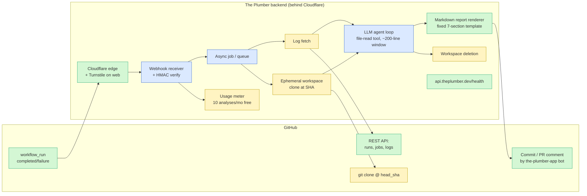
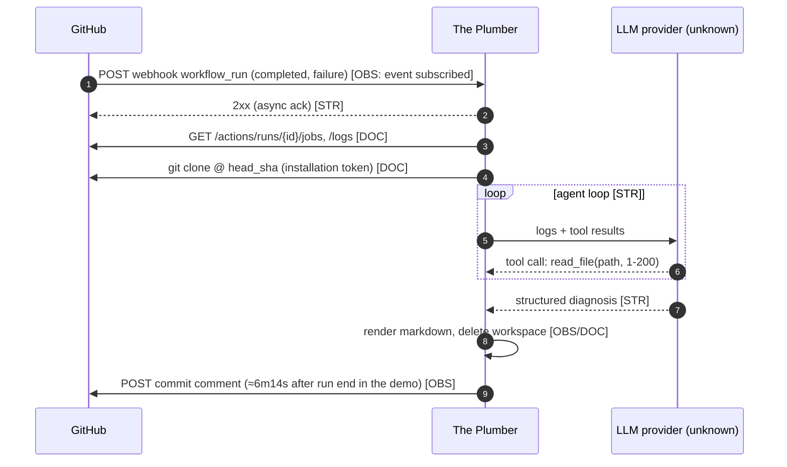
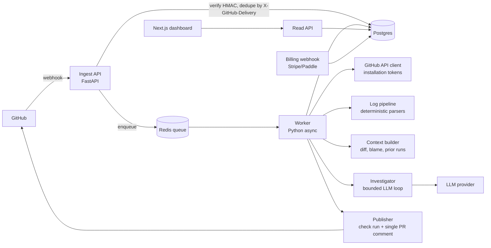
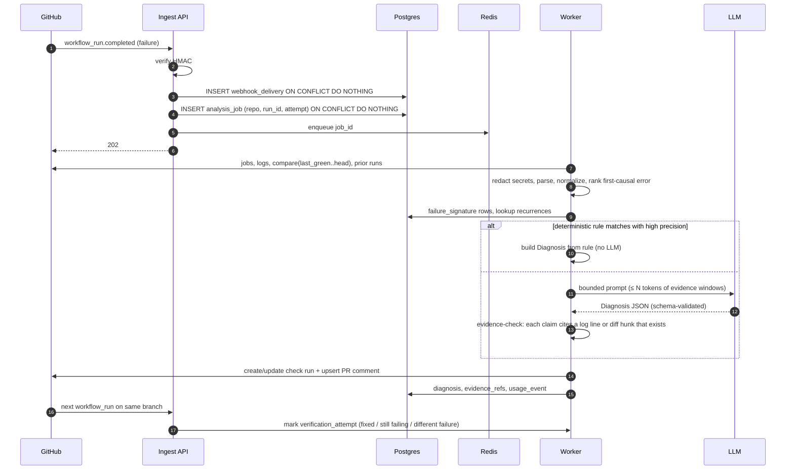

# 02 — Architecture Reconstruction

Research date: 2026-10-15.

**Evidence labels**

| Label | Meaning |
|---|---|
| **[OBS]** Observed | We saw it directly: GitHub API manifest, bot comment, REA capture |
| **[DOC]** Documented | The vendor's own Marketplace listing or docs say so |
| **[STR]** Strongly inferred | Multiple consistent artifacts point to it |
| **[SPEC]** Speculative | Plausible, but nothing in the evidence points to it |

The document has two parts:

- **Part A** reconstructs The Plumber.
- **Part B** is *our own* proposed design. It is not a claim about any competitor.

---

## Part A — The Plumber: evidence-labeled reconstruction

Nothing below asserts The Plumber's language, framework, database, queue, LLM vendor or orchestration library. There is **no evidence** for any of them: the site is Cloudflare-gated and there are no public repos, job posts or sub-processor list.

### A.1 System architecture



| Component | Label | Evidence / reasoning |
|---|---|---|
| GitHub App, 5 permissions, `workflow_run` only | [OBS] | `api.github.com/apps/the-plumber-app` |
| Cloudflare in front of web and API (`api.theplumber.dev`) | [OBS] | `cf-mitigated: challenge` on both hosts |
| Webhook receiver with signature validation | [STR] | GitHub Apps must validate `X-Hub-Signature-256` to be safe. It is universal practice, but we could not observe it. |
| Duplicate-event handling | [SPEC] | Not observable |
| Async job processing | [STR] | About 6 minutes elapsed between the webhook and the comment. A synchronous webhook handler would time out (GitHub allows 10 s). |
| Log retrieval via Actions API | [DOC] | Marketplace: "downloads the CI log" |
| Repo clone at failing commit | [DOC]+[STR] | Marketplace says so, and the path prefix `coffee_shop/coffee_shop/…` in the report fits a clone into a repo-named directory |
| LLM agent with file-reading tools | [STR] | "Files Examined… order.py (lines 1-200)" on a 30-line file implies a read tool with a default window. Per-file verdicts imply iterative exploration. |
| Failure classification | [SPEC] | No taxonomy visible. The report has only "confidence" and "fix complexity". |
| Report rendering | [OBS] | Fixed headings and emoji, consistent footer |
| Delivery as commit comment | [OBS] | Comment on `b2ef8a12` |
| Delivery as PR comment | [DOC] | Listing; `pull_requests: write` |
| Workspace destruction after report | [DOC] | Listing privacy claim |
| Usage metering | [DOC] | 10 analyses/month |
| Billing | Not found | No paid plan exists |
| Telemetry, observability, error reporting | [SPEC] | Not observable |
| Retry on failure | [SPEC] | Not observable |

### A.2 Observed and inferred event flow (The Plumber)



---

## Part B — Our proposed implementation (independent design)

**Design principle**, derived from the competitive evidence in `03`/`05`:

- **Deterministic first, LLM second.**
- **Evidence-linked claims.**
- **Explicit abstention.**
- **Read-only by default.**

### B.1 Component architecture



### B.2 Event and data flow (stage contracts)

| # | Stage | Input | Output | External deps | Failure conditions | Retry | Idempotency key | Security boundary | Latency / cost driver |
|---|---|---|---|---|---|---|---|---|---|
| 1 | Receive | HTTP POST, headers `X-GitHub-Event`, `X-GitHub-Delivery`, `X-Hub-Signature-256` | `webhook_delivery` row | — | Bad signature, unknown installation | No retry (GitHub redelivers) | `delivery_id` UNIQUE | Signature verified before parsing; body size cap | <50 ms |
| 2 | Filter | `workflow_run` payload | `analysis_job(queued)` or dropped | — | Not failure; repo not enabled; quota exceeded | — | `(repo_id, run_id, run_attempt)` UNIQUE | Tenant resolved from `installation.id` only | — |
| 3 | Fetch metadata | job | runs, jobs, steps, conclusion, head_sha, PRs, previous run on branch | GitHub REST | 404 (deleted), 403 (permission), rate limit | Exponential backoff 3× ; honor `Retry-After` | job id | Installation token scoped to the repo | 1–3 API calls |
| 4 | Fetch logs | failed job ids | raw logs → object storage (TTL) | `GET /actions/jobs/{id}/logs` | Logs expired (90-day default), truncated, >100 MB | 3× | job_id | Logs treated as **untrusted**; secret-redaction pass before storage and before LLM | Log size |
| 5 | Parse | raw logs | `failure_signature[]`: step, error class, normalized message, stack frames, first-error offset | — | Unknown format | — | hash(log) | — | CPU only |
| 6 | Context | signatures + SHAs | diff `base..head`, last-green SHA, changed files, lockfile diffs, runner image version, matching prior signatures | GitHub compare API, contents API | Compare too large | 2× | job id | Read only; no checkout by default | API calls |
| 7 | Investigate | signatures + context | `Diagnosis` JSON (§B.5) | LLM | Timeout, invalid JSON, budget exceeded | 1 repair retry, then **abstain** | job id + model version | Prompt-injection guard; no tool can write or execute | **Main cost** |
| 8 | Publish | Diagnosis | check run (always) + single upserted PR comment (if PR) | GitHub | 403/422 | 3× | `(repo, head_sha, check_name)` upsert | `checks:write`, `pull_requests:write` only | 1–2 calls |
| 9 | Feedback | 👍/👎, re-run result | `verification_attempt` | GitHub webhook (`check_suite`/`workflow_run` on the next SHA) | — | — | — | — | — |

### B.3 Sequence (ours)



### B.4 Data model (proposal)

All tenant tables carry `org_id`. Row-level security (`USING org_id = current_setting('app.org_id')`) adds defense in depth.

| Entity | Key fields | Relationships / constraints | Retention |
|---|---|---|---|
| `organization` | id, name, plan_id, created_at, data_region | 1–N installations | Life of account; hard-delete on request |
| `user` | id, github_user_id UNIQUE, email, created_at | N–M org via `membership(role)` | Same |
| `github_installation` | id, github_installation_id UNIQUE, org_id, account_login, suspended_at, permissions jsonb | | Soft-delete on `installation.deleted`; purge after 30 d |
| `repository` | id, github_repo_id UNIQUE, installation_id, full_name, private bool, enabled bool, default_branch | | Same |
| `webhook_delivery` | delivery_id PK, event, received_at, status | Idempotency guard | 14 d |
| `workflow_run` | id, repo_id, github_run_id, run_attempt, head_sha, head_branch, event, conclusion, pr_numbers int[], created_at | UNIQUE(repo_id, github_run_id, run_attempt) | 180 d |
| `workflow_job` | id, run_id, github_job_id UNIQUE, name, conclusion, runner_image, started_at, completed_at, log_object_key, log_expires_at | | Metadata 180 d; **raw log 7 d** |
| `failure_signature` | id, repo_id, fingerprint (sha256 of normalized error), error_class enum, normalized_message, first_seen_run_id, last_seen_run_id, occurrences int, is_flaky_suspect bool | UNIQUE(repo_id, fingerprint) | 365 d (no raw text beyond the normalized message) |
| `job_failure` | job_id, signature_id, log_line_start, log_line_end, is_primary bool, rank | Many-to-many between job and signature | 180 d |
| `diagnosis` | id, run_id, schema_version, category, root_cause, confidence numeric, abstained bool, model, prompt_tokens, completion_tokens, cost_usd, latency_ms, created_at | 1 per (run, attempt) | 180 d |
| `evidence_ref` | id, diagnosis_id, kind (log_line, diff_hunk, file_range, prior_run, external_status), locator jsonb, excerpt_redacted text, verified bool | Every claim must link to ≥1 | 180 d |
| `related_commit` | diagnosis_id, sha, role (suspect, last_green, first_bad), score | | 180 d |
| `suggested_remediation` | id, diagnosis_id, kind (code_patch, config_change, rerun, pin_dependency, investigate), patch_unified_diff, rationale, risk | | 180 d |
| `verification_attempt` | id, diagnosis_id, method (next_ci_run, sandbox_run, user_feedback), outcome (resolved, still_failing, different_failure, unknown), run_id, observed_at | | 365 d (aggregate accuracy metric) |
| `usage_event` | id, org_id, kind (analysis, llm_tokens), quantity, cost_usd, created_at | Append-only | 7 y (billing) |
| `subscription` | org_id PK, plan, status, provider_customer_id, period_end, analysis_quota | | Billing law |
| `audit_log` | id, org_id, actor, action, target, created_at | Append-only | 1 y |

**Multi-tenancy and isolation notes**

- Tenant resolution comes **only** from the signed webhook's `installation.id` mapped to `org_id`. Repo names in payloads are never trusted.
- Raw logs live in object storage under `org/{id}/…` with a short TTL. Raw source code is never persisted.
- An org deletion job cascades through all tables and object prefixes and writes an `audit_log` tombstone.

### B.5 AI investigation pipeline (ours)

**Recommendation: a deterministic pipeline plus a *bounded* single-call or two-call LLM step, not an open-ended agent.**

| Approach | Pros | Cons | Verdict |
|---|---|---|---|
| Single LLM call on the whole log | Trivial to build | Context overflow on large logs; latches onto the last error rather than the first causal one; costly | ✗ |
| Pure deterministic | Cheap, precise, explainable | Poor coverage on novel failures | Use as stage 1 |
| Open-ended agent (clone + tools) | Deep, handles novel cases (The Plumber, Copilot) | Minutes of latency; costly; hard to bound; larger attack surface; **commodity, since GitHub ships it** | ✗ for MVP |
| **Deterministic → bounded LLM (≤2 calls, fixed tools: `get_diff_hunk`, `get_file_range`)** | Predictable cost and latency; evidence-checkable | Misses some deep cases, which become **abstain + plan** | ✓ |

**Steps**

1. **Locate relevant log sections.**
   - Split by GitHub step markers (`##[group]`, `##[error]`, timestamps).
   - Keep only failed steps.
   - Inside a failed step, find the *first* error-like line using language-specific regexes: pytest `E   `, `FAILED`, `Traceback`; tsc `error TS\d+`; jest `●`; eslint; npm `ERR!`; pip `ResolutionImpossible`; docker `Error response from daemon`; `Process completed with exit code`.
2. **Normalize.**
   - Strip timestamps, ANSI codes, absolute paths (`/home/runner/work/x/x/` → repo-relative), hex addresses, temp dirs, durations and line-number noise.
   - Fingerprint = sha256(error_class + normalized top message + top 3 repo-local frames).
3. **Primary vs downstream.**
   - Order errors by timestamp and step order.
   - Mark as *downstream*:
     - "N tests failed" summaries;
     - errors in steps that depend on a failed build artifact;
     - cascades of the same ImportError.
   - Rank the primary error first.
4. **Retrieve code context.**
   - `compare(last_green_sha..head_sha)` gives changed files.
   - Intersect them with frames and files referenced in the error.
   - Include lockfile or manifest diffs (`package-lock.json`, `poetry.lock`, `requirements*.txt`, `uv.lock`).
   - Fetch only the ±40 lines around referenced locations. **No full clone in the MVP.**
5. **Competing hypotheses.** Deterministic priors produce candidate categories:
   - `code_regression`: the error references a changed file or line;
   - `test_defect`;
   - `dependency_drift`: lockfile unchanged but the resolved version differs from the last green run, or there is a resolver error;
   - `infra_runner`: a runner image changed, an OOM, `No space left`, exit 137, or a GitHub incident;
   - `flaky`: the same fingerprint passed on the same SHA, or there are prior intermittent occurrences;
   - `config_secret`: an empty env var or "secret not found".

   The LLM receives the candidates **plus their evidence** and must pick one, rank the others, or abstain.
6. **Gather more evidence when needed.** The LLM may call at most **2 tools**, `get_file_range` and `get_diff_hunk`, with a token budget.
7. **Structured diagnosis.** JSON schema (below), validated with Pydantic. On invalid output, retry once with a repair prompt, then abstain.
8. **Calibrated confidence.**
   - Confidence = f(rule precision, evidence-check pass rate, agreement between deterministic prior and LLM, recurrence history).
   - Calibrate against the labeled benchmark (`04`) using reliability bins.
   - Show **bands** (likely / possible / unclear), not fake precision.
9. **Minimal remediation.**
   - Only when the category is `code_regression`, `test_defect` or `config` *and* confidence ≥ threshold.
   - Otherwise output a **diagnostic plan**: the 1–3 cheapest next steps, e.g. "re-run job to test flakiness", "pin `foo==1.2.3` (last green resolved version)", "check secret `X` exists in env `prod`".
10. **Verification without overclaiming.**
    - The MVP verifies via the **next CI run on the same branch** and reports `resolved`, `still_failing (same fingerprint)`, `different_failure` or `unknown`.
    - It never says "verified" for a fix it did not observe passing.
    - Sandbox re-execution is post-MVP.

**Evidence check (anti-hallucination gate).** Every `claims[].evidence` locator must resolve to:

- an actual log line (by index, with the normalized substring present);
- or a diff hunk;
- or a file range.

If a claim fails the check it is dropped. If the root-cause claim itself fails, the run **abstains**.

**Diagnosis schema (v1)**

```json
{
  "schema_version": "1",
  "run": {"repo": "org/name", "run_id": 123, "attempt": 1, "head_sha": "…"},
  "status": "diagnosed | abstained",
  "category": "code_regression | test_defect | dependency_drift | infra_runner | flaky | config_secret | unknown",
  "primary_failure": {
    "job": "test (3.11)", "step": "pytest",
    "fingerprint": "sha256:…",
    "summary": "assert 0.21 == 2.71 in test_single_item_total",
    "log_ref": {"job_id": 1, "line_start": 210, "line_end": 214}
  },
  "downstream_failures": [{"fingerprint": "…", "reason": "same root cause"}],
  "root_cause": {
    "statement": "calculate_total returns only tax",
    "location": {"path": "coffee_shop/pricing.py", "line": 41},
    "evidence": [{"kind": "log_line", "ref": {"job_id": 1, "line": 212}},
                 {"kind": "file_range", "ref": {"path": "coffee_shop/pricing.py", "start": 38, "end": 42}}]
  },
  "attribution": {
    "first_bad_sha": "3019c977", "last_green_sha": null,
    "triggering_commit_changed_relevant_files": false,
    "statement": "Failure pre-dates this push; introduced in 3019c977"
  },
  "alternatives": [{"category": "test_defect", "why_less_likely": "…"}],
  "confidence": {"band": "likely", "score": 0.82, "basis": ["rule:pytest-assert", "evidence_check:2/2", "diff_intersects_trace"]},
  "remediation": {
    "kind": "code_patch | config_change | rerun | pin_dependency | investigate",
    "patch": "--- a/…\n+++ b/…",
    "next_steps": ["…"],
    "risk": "low"
  },
  "recurrence": {"seen_before": false, "occurrences": 0, "first_seen_run": null},
  "abstention_reason": null
}
```

**Verification result schema**

```json
{
  "diagnosis_id": "…",
  "method": "next_ci_run | sandbox_run | user_feedback",
  "observed_run": {"run_id": 456, "head_sha": "…"},
  "outcome": "resolved | still_failing_same_fingerprint | different_failure | not_rerun | unknown",
  "fix_applied_matches_suggestion": "yes | partial | no | unknown",
  "notes": "Resolved on next push; diff touched pricing.py:41 as suggested."
}
```

**Risk controls**

| Risk | Control |
|---|---|
| Context limits | Send only evidence windows (first-error ±N lines, ≤ ~12k tokens), never whole logs |
| **Prompt injection in logs or repo files** | Logs, test output and file contents can be attacker-controlled (fork PRs, malicious deps). Controls: wrap them as data with delimiters; the system prompt says to ignore instructions inside data; the LLM has **no write or execute tools**; output is schema-only; the publisher never renders raw links or HTML from model output and escapes markdown/mentions (`@` → `@​`) to prevent pinging people |
| Malicious repo content | No checkout or execution in the MVP; only fetch text ranges via API |
| Token cost | Deterministic short-circuit for common classes; small model first, escalate to a larger one only on ambiguity |
| Latency | Target p50 < 60 s. Dominated by log download plus 1 LLM call. |
| Model choice | Use a structured-output-capable mid-tier model by default (e.g. Claude Sonnet / Haiku tier), with an eval suite gating any model change |
| Failure recovery | Any stage failure → publish "analysis unavailable" check (neutral) rather than nothing; job retried ≤3 |

### B.6 Security and privacy architecture (ours)

| Area | Design |
|---|---|
| **Least-privilege permissions** | MVP: `actions:read`, `checks:write`, `contents:read`, `metadata:read`, `pull_requests:write`. `contents:read` is needed for compare/diff and file ranges. Offer a **"logs-only" mode** without `contents` (FailBrief-equivalent) for cautious teams. |
| Write-capable features | Fix-PR creation (`contents:write`) is a **separate, opt-in GitHub App** ("Tracewise Fixer"), so the default app can never push. |
| Private code | Not persisted. Only ≤80-line excerpts are referenced by locator; excerpts stored redacted for 180 d (configurable to 0). |
| Log and secret redaction | GitHub already masks registered secrets (`***`). We add a regex and entropy pass (AWS keys, JWTs, `ghp_`, private keys, connection strings) before storage and LLM calls. |
| Tenant isolation | `org_id` on all rows plus Postgres RLS; per-org object prefixes; installation tokens minted per job and never cached across orgs |
| Temporary checkouts | Not in the MVP. Post-MVP: ephemeral microVM (Firecracker / gVisor) with no network egress except a package-proxy allowlist; destroyed after the job. |
| Sandboxed execution / command restrictions | Post-MVP only. Allowlisted commands derived from the workflow file; CPU and time limits; no secrets injected. |
| Untrusted workflow artifacts | Never downloaded in the MVP |
| Encryption and retention | TLS everywhere; at-rest encryption (managed PG / S3 SSE); retention table above; per-org override |
| Customer-controlled deletion | Dashboard "Delete all data" plus an automatic purge 30 d after uninstall |
| Audit logs | Every publish, setting change and data deletion is appended |
| AI-generated patches | Shown as suggestions (a GitHub ` ```suggestion ` block on PRs), never auto-committed by the default app |
| LLM provider | Zero-retention API settings; listed as a sub-processor; BYO-key option on a higher tier |

**Read-only by default:** log reading, diff reading, check-run and comment publishing.

**Explicit authorization required:**

- creating branches or PRs;
- re-running jobs (`actions:write`);
- sandboxed execution;
- storing source excerpts beyond 0 days;
- sending code to a non-default LLM.

---

## Confidence summary

| Inference | Confidence |
|---|---|
| The Plumber clones the repo and uses an LLM with file-reading tools | High: listing plus two independent artifacts in the report |
| The Plumber processes asynchronously | High: timing |
| The Plumber validates signatures and dedupes | Unknown: standard practice only |
| The Plumber's stack, LLM vendor and storage | Unknown: no evidence |
| Our proposed design is buildable in 2–4 weeks by the team | Medium-high: no execution or sandboxing in the MVP; scope in `06` |
