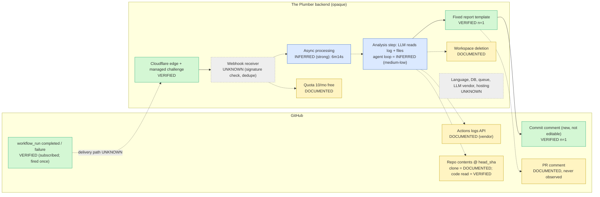
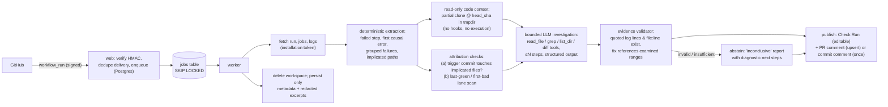

# Final Reverse-Engineering Audit: The Plumber

| Field | Value |
|---|---|
| Audit date | 2026-10-17 |
| Auditor | Claude Code session, working on the user's machine |
| Scope | Re-verify every material competitor claim in `research/` (01–08, EXECUTIVE-SUMMARY and the planning documents); use the REA tooling that is available; reconstruct the observable workflow; correct errors |
| Raw evidence | `research/final-audit/evidence/`, saved and timestamped (`fetched_at.txt`) |
| Existing research files | **Not modified.** Corrections are listed in §9 and summarised in §11. |

Companion deliverables:

- [VERIFIED-FEATURE-SPEC.md](VERIFIED-FEATURE-SPEC.md)
- [TRACEWISE-PARITY-ACCEPTANCE-TESTS.md](TRACEWISE-PARITY-ACCEPTANCE-TESTS.md)

## Evidence classes used in this document

| Class | Meaning |
|---|---|
| **VERIFIED** | Directly observed by us, or confirmed by strong primary evidence (GitHub API, GitHub-hosted artifact, a REA capture we ran) |
| **DOCUMENTED** | Stated by the vendor (Marketplace listing, report text) or by GitHub's docs, but not independently exercised |
| **INFERRED** | A reasoned hypothesis from indirect evidence |
| **UNKNOWN** | The evidence does not support a reliable conclusion |

> GitHub platform behaviour, such as permission tables or webhook delivery rules, is marked **DOCUMENTED (GitHub)**. It is the platform's primary documentation, but we did not exercise it in a live App.

---

## 1. Executive verdict

1. **The Plumber's observable product is small and well understood.** It is:
   - a GitHub App with five read-mostly permissions;
   - triggered only by `workflow_run`;
   - posting one structured markdown "Plumbing Report" as a commit comment (seen once) or a PR comment (advertised, never seen).

   Everything between the webhook and the comment (backend, stack, LLM, storage, orchestration) is **UNKNOWN**. Cloudflare blocks all of the vendor's own surfaces.
2. **The public evidence of real output is a single report**, produced by the vendor on its own demo repo on launch day. GitHub search finds **zero** PR or issue comments by `the-plumber-app[bot]` anywhere. **No experiment against the competitor has ever been run** by us, in the earlier research or this audit.
3. **Several prior findings were overstated or wrong** (§9):
   - "Fixed 200-line read window" is weakened to *inconsistent ranges* and cannot be relied on.
   - "Agentic tool loop" is downgraded from High to Medium-low.
   - `/examples` and `/support` were reported as blocked but were never requested. They were tested today, and they are blocked.
   - REA was described as the primary tool, but in practice it contributed only one blocked capture of the competitor.
   - "`gh` unauthenticated" is now stale.
4. **The Tracewise implementation plan does not deliver functional parity with The Plumber's observable workflow.** It is an attribution product: no code-level root cause, no problematic line, no recommended fix, no Files Examined, the LLM off by default, and no code reading beyond lockfiles and test files. It also mis-states that no output channel exists without `pull_requests:write` or `checks:write` (§9, C-P1).
5. **Decision (§12): READY AFTER SPECIFIC CORRECTIONS** for implementing core parity. The observable workflow is sufficiently understood. The plan must be corrected first. A head-to-head competitor benchmark needs the user's approval to install The Plumber on a test org. It strengthens the *differentiation* claim but is not a prerequisite for parity.

---

## 2. What had already been done (audit of prior work)

Source: a line-by-line audit of the earlier session transcript, `~/.claude/projects/-home-Krishna-Singh-tracewise/737af3f8….jsonl`, and its 5 subagent transcripts. The audit used only parsed tool calls and results.

### 2.1 Tools actually invoked (prior session)

| Tool | Calls | What it established about The Plumber |
|---|---|---|
| REA `binary_session` (MCP) | 2 | REA 6.5.0 capability inventory; nothing about the target |
| REA `capture_browser_scenario` (MCP) | 2 runs (+1 empty call) | theplumber.dev returned 307 then 403, a Cloudflare challenge (`ev_bd805a79…`). The other run captured FailBrief successfully (`ev_02389147…`). |
| REA `analyze_web_bundle`, `export_web_scripts`, `inspect_web_page`, HAR tools | **0** | Schemas were loaded but never called; there was no reachable Plumber bundle to analyse |
| In-app browser | 14 | Cloudflare "Verify you are human" page only. The user rejected the first navigation. |
| curl / WebFetch, unauthenticated GitHub REST | ≈20 | Manifest, org, demo repo, commits, run, job and bot comment. Unauthenticated job-log download returned 403. |
| WebFetch / WebSearch (all subagents) | 142 / 78 | Marketplace page, crt.sh, Wayback (empty), HN Algolia (no hits), and competitor and market sources |
| `gh api` | **0** | `gh` was not logged in |

### 2.2 Sources and artifacts retained by the prior session

- The 17 research markdown files.
- Two REA capture outputs and two in-app browser screenshots, kept under the prior session's `tool-results/`.
- The prior session's scratchpad (app JSON, comment JSON, Marketplace HTML) **no longer exists**.
- No HAR, pcap or exported Evidence bundle was saved.

### 2.3 Experiments performed by the prior session

**None.** No App was installed, no repo created, no CI triggered, no benchmark run. `04-failure-benchmark.md` correctly says "No product was benchmarked by us".

### 2.4 Prior-work classification

| Category | Items |
|---|---|
| Independently verified | App manifest; Marketplace text; demo repo timeline; bot comment text and timing; Cloudflare block on `/`; crt.sh first cert 2026-04-12; no Wayback snapshots |
| Vendor claims treated as fact in places | Repo clone; "agentic analysis"; PR-comment delivery; code destroyed after the report; <2 min latency |
| Inference treated too strongly | Fixed 200-line read tool → LLM tool loop (08 §6 rated it "High"); per-analysis cost from the 10/month cap (used by ADR-08) |
| Claimed but not performed | Blocking of `/examples` and `/support` (never requested); 307→403 "on all paths" (seen only on `/` via REA) |
| Never investigated | Upstream repo's commit comments; Marketplace "Transparency" tab; DNS (`dig` missing); GitHub search for bot activity with authentication; whether the demo logs remain retrievable |
| Unsuccessful because of access | theplumber.dev content; api.theplumber.dev; Reddit; job logs (unauthenticated) |

---

## 3. What this audit did (2026-10-17)

The REA MCP server is registered but **failed to connect in this session**. The session was opened inside the `~/rea` source checkout, where `npx rea-agents` resolves to the unbuilt local package (`rea: command not found` in the MCP log). REA was therefore driven through its **CLI** (`npx rea-agents@6.5.0 …`) from `$HOME`, which works.

### 3.1 Capability ledger

| Capability | Exists in this environment | Used | Target | Outcome | Evidence |
|---|---|---|---|---|---|
| REA `capture-browser-scenario` (Playwright, Chromium 154) | Yes | **Yes, ×4** | `https://theplumber.dev/` | Cloudflare challenge only: 307, then 403/401, then `challenges.cloudflare.com` Turnstile. No app content. | `ev_2fb4bd45e096d5f6138638b70bc76610b7239bfddcf00b5f8efdd122ee248845` → `evidence/rea/capture-theplumber_dev_.json` |
| | | | `https://api.theplumber.dev/health` (the Marketplace "status URL") | Same Cloudflare challenge | `ev_91ed80f3bd197b7aaaa9299d13e2863e709e179cacd0fff1b13cdaf883da4bc2` |
| | | | `github.com/marketplace/the-plumber-app` | Accessibility tree captured | `ev_a6c3d0e3779ff98071491abab50dcd88201b35ac112e4c00a1ef541ae492e6b4` |
| | | | `github.com/apps/the-plumber-app` | Accessibility tree captured (no permission list is rendered on this page) | `ev_ef13766c2360c1a06ef21fc87bbaf16e0875393d90ea272cf835138df8ed80a4` |
| REA `analyze-web-bundle`, `export-web-scripts`, `recover-javascript-sources`, `trace-web-source-location` (source maps) | Yes | **No** | — | There is no reachable first-party bundle: every Plumber host serves only Cloudflare challenge scripts. Analysing Cloudflare's scripts would say nothing about The Plumber. | — |
| REA `inspect-web-page` / `observe-web-session` (passive CDP) | Yes | No | — | The same blocker; they need a rendered first-party page | — |
| REA `inspect-web-network-capture` (HAR) | Yes | No | — | We have no HAR of first-party traffic. The capture network events above are retained. | — |
| REA native, Android and firmware tools (Ghidra, JADX, etc.) | Ghidra, IDA, JADX and Hopper not configured | No | — | Not relevant: The Plumber ships no binary | — |
| REA evidence ledger (`evidence-export`, `build-reconstruction-obligation-ledger`) | Yes | No | — | The capture JSON files carry content digests and evidence IDs; a separate ledger adds no new facts | — |
| GitHub REST and GraphQL, **authenticated** (`gh`, account `ksingh-rovn`) | Yes (new since the prior research) | **Yes** | App manifest, org, repos, demo repo commits, comments, runs, jobs, logs, pulls, issues, forks, upstream repo, Marketplace listing (GraphQL), search | Success. Logs return **HTTP 410 (expired)**. | `evidence/*.json` |
| GitHub search, authenticated (issues/PRs, code, commits) | Yes | **Yes** | `commenter:app/the-plumber-app`, `author:app/…`, `involves:app/…`, `commenter:the-plumber-app[bot]`, phrase searches | **0** bot comments; phrase searches return only unrelated noise | Command log in this document |
| GitHub docs (raw article API) | Yes | **Yes** | Permissions required for GitHub Apps; webhook events | Commit-comment and Check Run permissions confirmed; `installation` delivered to all Apps | `evidence/gh-perms.md`, `evidence/gh-webhooks.md` |
| DNS-over-HTTPS (dns.google) | Yes | **Yes** | theplumber.dev, api., www., _dmarc. | Cloudflare-proxied A/AAAA, Cloudflare NS, Cloudflare Email Routing MX, SPF only | `evidence/dns.txt` |
| Certificate Transparency (crt.sh) | Yes | **Yes** | `%.theplumber.dev` | 12 certs, names `theplumber.dev` and `*.theplumber.dev` only, 2026-04-12 → 2026-10-06 | `evidence/crtsh.json` |
| curl status probes | Yes | **Yes** | 9 site paths and 8 API paths | All return a `cf-mitigated: challenge` / 403 | `evidence/site-paths.txt` |
| Real public CI-failure mining (ground truth) | Yes | **Yes** (subagent) | Public repos | See §7 | `evidence/benchmark/` |
| Installing The Plumber on a test repo | Possible only with the user's approval | **No** | — | **Requires approval** (§12) | — |

Not attempted, by policy: solving or bypassing the Cloudflare challenge; POSTing to any Plumber endpoint, including a guessed webhook; contacting the vendor; collecting personal information about the developer.

---

## 4. Findings register

Every row was re-checked on 2026-10-17 unless stated.

| # | Claim | Class | Source / artifact | Method | Proves | Does not prove | Corroboration | Confidence |
|---|---|---|---|---|---|---|---|---|
| F1 | App `the-plumber-app` (id 3376027) requests `actions:read`, `checks:read`, `contents:read`, `metadata:read`, `pull_requests:write` | VERIFIED | `evidence/app-manifest.json` | `gh api apps/the-plumber-app` | The current permission set | Which permissions it actually exercises; permissions at the time of the 2026-04-14 demo (App updated 2026-04-15T22:57Z) | Same in the prior-session fetch | High |
| F2 | Subscribed events: `workflow_run` only | VERIFIED | same | same | Only `workflow_run` deliveries plus the default `installation` events (GitHub docs) | Which `action`/`conclusion` values it acts on | Marketplace: "listens for `workflow_run` failure events" (DOCUMENTED) | High |
| F3 | It cannot create Check Runs or edit/delete commit comments | VERIFIED (by inference from F1 + GitHub docs) | `evidence/gh-perms.md`: `POST …/check-runs` needs Checks write; `PATCH/DELETE …/comments/{id}` needs Contents write | Docs plus manifest | Its only possible output surfaces are a *new* commit comment (Contents read is enough) and PR/issue comments via `pull_requests:write`, which *can* be edited | Whether it edits PR comments in practice | — | High |
| F4 | Distribution: GitHub App only; no Action, CLI or dashboard found | VERIFIED (absence in the public org) + DOCUMENTED ("No config changes. No new CLI tools. No dashboard") | `evidence/org-repos.json`, `evidence/marketplace-graphql.json` | API | No public Action or CLI | No private tooling | — | High |
| F5 | Marketplace: **4 installs**; one plan, **Free $0**: 10 analyses/month, public repositories, "Full Plumbing Report on every failure", "Commit & PR comments"; not verified; categories CI and AI Assisted | VERIFIED (GitHub-displayed) | `evidence/marketplace.html`, `ev_a6c3d0e3…` | curl + REA capture, 2026-10-17 | Current listing state; **unchanged since 2026-10-15** | Private usage; whether any off-Marketplace paid plan exists (site blocked) | Matches the 2026-10-15 fetch | High |
| F6 | Vendor-described pipeline: download CI log → clone repo at failing commit → "agentic analysis through the actual codebase" → post report "on your commit or PR — in under two minutes" | DOCUMENTED | `evidence/marketplace-graphql.json` `extendedDescription` | GraphQL | What the vendor claims | Any of it beyond what the one report shows | Partially consistent with F9–F11 | Medium |
| F7 | Privacy claim: "Your code is never stored… destroyed immediately after the report is posted" | DOCUMENTED | same | same | The claim | Actual retention, sub-processors, LLM provider; the privacy policy page is blocked | None | Low (as fact) |
| F8 | theplumber.dev and api.theplumber.dev, on every probed path, return a Cloudflare managed challenge | VERIFIED | `ev_2fb4bd45…`, `ev_91ed80f3…`, `evidence/site-paths.txt` | REA headless Chromium, curl | No content is reachable without passing a human check | Anything about the origin | Prior session saw the same (`ev_bd805a79…`, in-app browser) | High |
| F9 | Exactly **one** public report exists: a commit comment by `the-plumber-app[bot]` on `theplumber-dev/coffee_shop@b2ef8a12`, 2026-04-14T14:49:20Z, 2,218 chars, not line-anchored (`path`/`line` null), not edited | VERIFIED | `evidence/commit-comments.json`, `evidence/plumbing-report-b2ef8a12.md` | API | Format and content of one report | Typical output; PR-comment format | `commenter:` searches = 0 (F12) | High (n=1) |
| F10 | The report was posted **6 m 14 s** after the run's `updated_at` (14:43:06Z), and 6 m 19 s after the job completed (14:43:01Z) | VERIFIED | `evidence/runs.json`, `evidence/run-jobs.json` | API timestamps | Latency of this one event | Typical latency; whether it was triggered manually or hit a cold start | — | High (n=1) |
| F11 | The report's diagnosis and fix are **correct** | VERIFIED | `evidence/demo-src/*` | Source read at `b2ef8a12`; arithmetic check of `subtotal*(1+0.085)` against all 4 asserted totals (2.71, 8.68, 11.07, 12.21) | Correct root cause, location (`pricing.py:41`) and fix | Generalisation | — | High |
| F12 | No PR or issue comment by the bot is findable on public GitHub | VERIFIED (bounded) | `gh api search/issues` with `commenter:app/the-plumber-app`, `author:`, `involves:`, `commenter:the-plumber-app[bot]` → 0 | Authenticated search | No indexed public issue/PR comments | Commit comments (not searchable); private repos (out of scope for the free plan) | Prior subagent got the same 0 unauthenticated | Medium-high |
| F13 | The report gives **no attribution**. The triggering commit `b2ef8a12` changes only `README.md` (+3). The defect was introduced in `3019c977` and failed upstream CI twice (14:24:58Z, 14:28:20Z) before the fork existed (14:40:05Z). The report says neither. | VERIFIED | `evidence/commits.json`, `evidence/upstream-runs.json`, commit diff | API | The gap on this case | That The Plumber *never* attributes; this run had **no in-repo history** (the fork's first run), so even a history-based tool might lack a baseline (§9 C-P7) | — | High (n=1) |
| F14 | Report artifacts: the path prefix `coffee_shop/coffee_shop/…` (the real path is `coffee_shop/pricing.py`); "Files Examined" lists `pricing.py (lines 1-43)`, exactly the file's length, and `order.py (lines 1-200)` on a 30-line file; "Failed step" gives the *command* `pytest --tb=short -v`, not the step name "Run pytest"; no job name, run link or SHA | VERIFIED (text); interpretation INFERRED | `evidence/plumbing-report-b2ef8a12.md`, file line counts via the contents API | Comparison | That the paths and ranges are not normalised to the repo root and are not consistent with a single fixed window | Whether a tool loop, a single prompt with the files inlined, or model-written text produced them | — | See F15 |
| F15 | The Plumber uses an LLM with file-reading tools | INFERRED, **downgraded to medium-low** | F6 + F14 | Reasoning | Some file content reached the model (the report quotes line 41 exactly; the vendor claims a clone) | A *tool loop*. Ranges "1-43" and "1-200" are inconsistent with one fixed window, and could be model-authored. A single prompt with files inlined would produce the same report. | Vendor says "agentic" (DOCUMENTED) | Medium-low |
| F16 | Asynchronous processing | INFERRED (strong) | F10, plus GitHub's documented 10 s webhook response expectation | Reasoning | Work continued well past any webhook response window | Queue technology or retries | — | High |
| F17 | DNS is Cloudflare-proxied (A 104.21.51.67 / 172.67.176.237), with Cloudflare NS, Cloudflare Email Routing MX, and SPF only. CT shows only the apex and wildcard names, first certificate 2026-04-12. | VERIFIED | `evidence/dns.txt`, `evidence/crtsh.json` | DNS-over-HTTPS, crt.sh | Edge provider; no other public subdomain names | **Origin hosting, framework, database, queue, LLM provider: UNKNOWN** | — | High (edge) / none (origin) |
| F18 | All guessed API paths (`/`, `/docs`, `/openapi.json`, `/webhook`, …) on api.theplumber.dev return 403 to anonymous GETs | VERIFIED | `evidence/site-paths.txt` | curl GET only | The edge challenges ordinary clients | The webhook URL, or whether GitHub's POSTs bypass the challenge (they must, but how is unknown) | — | High (narrow) |
| F19 | The demo run's logs are no longer retrievable: HTTP **410** | VERIFIED | `evidence/run-logs.err` | Authenticated `gh api …/runs/24405466283/logs` | The "What Failed" excerpt cannot be re-checked against the raw log | — | Consistent with the 90-day default retention (DOCUMENTED, GitHub) | High |
| F20 | The CI workflow triggers on `push` to all branches and on `pull_request`. One job, "Tests (Python 3.11)", on `ubuntu-latest`; a failing step runs `pytest --tb=short -v`. | VERIFIED | `evidence/demo-src/.github_workflows_ci.yml`, `evidence/run-jobs.json` | API | Demo context | — | — | High |
| F21 | The report's confidence label ("High") and "Fix complexity" field have no stated basis | VERIFIED (text) | F9 | Read | Field presence | Whether low/abstain values exist | — | High |
| F22 | No public changelog, docs, release or issue tracker. App last updated 2026-04-15; org has 1 repo; no PH/HN/Reddit launch found (bounded search, 2026-10-15) | VERIFIED (absence, bounded) | `evidence/org*.json`; prior-session search log | API + search | No visible activity since April | Off-GitHub activity | — | Medium |

---

## 5. Reconstructed observable workflow (stage by stage)

### A. Installation and integration

| Question | Answer | Class |
|---|---|---|
| How is it installed? | GitHub Marketplace → Install GitHub App, free plan | VERIFIED (listing) |
| Permissions | F1 | VERIFIED |
| Trigger events | `workflow_run`, plus `installation` delivered by default | VERIFIED + DOCUMENTED (GitHub) |
| Integration type | GitHub App; no Action, CLI or dashboard | VERIFIED / DOCUMENTED |
| Configuration | "No config changes" | DOCUMENTED |
| Behaviour on install, uninstall, missing permissions, or a private repo on the free plan | Not observable | **UNKNOWN** |

### B. Event ingestion and orchestration

| Question | Answer | Class |
|---|---|---|
| Relevant payload fields | `workflow_run.id`, `head_sha`, `head_branch`, `event`, `conclusion`, `pull_requests[]`, `repository`, `installation.id`. These are needed to fetch logs and to choose a commit or PR target. | INFERRED (from the API it must call) |
| Which conclusions trigger analysis | A `failure` on a `push` triggered it once. `timed_out`, `cancelled`, `startup_failure` and re-runs are unknown. | VERIFIED for `failure`/`push`; others UNKNOWN |
| Dedupe, retries, concurrency | Not observable. Commit comments cannot be edited (F3), so any re-run that triggers analysis would add a comment. | UNKNOWN; constraint VERIFIED |
| Execution model | Asynchronous; the report took about 6 minutes | INFERRED (strong) |
| Webhook endpoint and signature validation | Unknown, behind Cloudflare | UNKNOWN |

### C. Context retrieval

| Question | Answer | Class |
|---|---|---|
| Logs | "Downloads the CI log" (vendor). The report quotes a pytest failure line consistent with the log. | DOCUMENTED + consistent |
| Repository contents | "Clones the repository at the failing commit" (vendor). The report quotes `pricing.py:41` verbatim and names a second file. | DOCUMENTED; that code was read is VERIFIED (it quotes code that is not in the log); the mechanism (clone vs API) is UNKNOWN |
| Files examined | 2 files, with self-reported ranges | VERIFIED (text) |
| Commit history or diff inspection | No evidence. The report never mentions commits. | UNKNOWN (no positive evidence) |
| Limits (log size, repo size, context) | Not observable | UNKNOWN |

### D. Failure analysis

| Question | Answer | Class |
|---|---|---|
| Identifies the relevant error | Yes, on n=1: the first failing assertion, with 3 sibling failures grouped under one cause | VERIFIED (n=1) |
| Reads repository code | Yes: it quotes non-log source | VERIFIED |
| Correlates with earlier runs or commits | No sign of it on n=1; it missed that the failure pre-dated the push | VERIFIED absence (n=1) |
| Distinguishes regression, pre-existing, flaky, dependency, infra | No category field; only "Confidence" and "Fix complexity" | VERIFIED (schema, n=1); behaviour on other classes UNKNOWN |
| Agent vs pipeline vs single call | The vendor says "agentic". The artifacts are ambiguous (F15). | DOCUMENTED / INFERRED (medium-low) |

### E. Report generation and publishing

| Question | Answer | Class |
|---|---|---|
| Sections | Header; Summary (failed step, root cause, confidence, fix complexity); What Failed; Why It Failed; Problematic Code (path + line + snippet); Recommended Fix (replacement + rationale); Files Examined (path, range, verdict); For AI Agents (edit steps + verify command); footer link | VERIFIED (n=1) |
| Surface | Commit comment (seen); PR comment (advertised, never seen) | VERIFIED / DOCUMENTED |
| Not a Check Run | Cannot be (no `checks:write`) | VERIFIED (F3) |
| Inconclusive or failed analysis | Not observable | UNKNOWN |
| Links back to the run, job or commit | None in the report | VERIFIED (n=1) |

### F. Security, privacy and reliability

| Topic | Evidence | Class |
|---|---|---|
| Webhook authenticity | None observable | UNKNOWN |
| Least privilege | Read-only except `pull_requests:write`. No `contents:write`, so it cannot push. | VERIFIED |
| Credential handling | None observable | UNKNOWN |
| Code and log retention, workspace cleanup | Vendor claim only | DOCUMENTED |
| Network isolation, prompt-injection defences | None observable | UNKNOWN |
| Rate limits, quotas | "10 analyses / month" (free) | DOCUMENTED |
| Monitoring | A status URL is declared (`api.theplumber.dev/health`) but blocked | VERIFIED (declared); content UNKNOWN |

### G. Backend and infrastructure

**Opaque.** The only verified facts:

- Cloudflare DNS, CDN, WAF and Email Routing (F17);
- an API hostname `api.theplumber.dev` behind the same edge.

Not found anywhere: language, framework, database, queue, hosting origin, LLM provider, model, observability, sub-processors. **We do not assert any of them.**

---

## 6. Part A: The Plumber reconstruction (evidence-classified)

Solid arrows are observed; dotted arrows are inferred or claimed. There is no claim about internals beyond what the table in §4 supports.

---

## 7. Failure-scenario investigation and benchmark

### 7.1 Competitor output actually observed

| Case | Ground truth (established from history) | Plumber output | Root cause | Attribution | Evidence quality | Uncertainty handling | Latency |
|---|---|---|---|---|---|---|---|
| coffee_shop `b2ef8a12` (run 24405466283) | Defect `pricing.py:41`, introduced in `3019c977` (14:21Z), red since its first CI run upstream. The trigger commit is README-only. Fork repo with no prior in-repo runs. | Correct mechanism, line and fix | ✅ | ❌ No "pre-dates this push", no introducing commit | Good: quotes the assertion, and the code line exists. The path is mis-prefixed. | "High", no basis given; appropriate in this case | 6 m 14 s |

**No other competitor output exists in public.** Cases 1–8 below are **offline ground truth only**. They have **not** been run against The Plumber, and no conclusion about its performance on them is drawn.

### 7.2 Real public failure cases mined for the benchmark (ground truth only)

We mined **15 real public GitHub Actions failures** (runs from 2026-09-10 to 2026-10-16) and established ground truth from the API.

- **Ground-truth sources:** run attempts, the lane history (last green and first red), commit diffs, the next green run and fix commit, runner-image metadata, and upstream release timestamps (PyPI JSON).
- **Artifacts:** per-case JSON and the failing job log are in `evidence/benchmark/` (`case-XX.json`, `case-XX-job-*.log`, `INDEX.md`).
- **Spot-check:** run IDs, events, trigger-commit file lists and quoted log lines were re-checked by us for cases 02, 04, 07, 12 and 14.

| Case | Scenario(s) | Repo / run | Ground truth (short) | Introducing change | Abstain? |
|---|---|---|---|---|---|
| R-01 | 5 flaky | fastapi/typer 37359154461 | Windows subprocess 5 s timeout, 1/7 matrix legs; the trigger is a uv.lock bump of an unrelated dependency (trap for "dependency") | flaky | No |
| R-02 | 3, 6, 7 | honojs/hono 37279910499 | Codecov CLI download, TLS handshake failure (log l.393); the final gpg "could not verify" lines are downstream | external; the trigger touches only CONTRIBUTING.md | No |
| R-03 | 3, 4 | pallets/flask 34252544596 | Werkzeug `main` deprecated `ImmutableDict`; the warning is treated as an error. The trigger edits docstrings in `app.py`, the same file as the traceback (attribution trap). | external (werkzeug #3267) | No |
| R-04 | **2 pre-existing** | pallets/flask 37632626982 | Same failure red since 2026-09-08; the trigger changes only `CHANGES.rst` | pre-existing (since d73fa1cdcb) | No |
| R-05 | **1 regression** | pallets/flask 37633292268 | mypy: `Mapping` vs base `dict` annotation at app.py:206 | 329c32b916 (fixed by d086db856b) | No |
| R-06 | 4 dependency | tox-dev/tox 35674178613 | New `ty 0.0.83` diagnostic; the trigger changes an unrelated docs pin | external (ty release) | No |
| R-07 | 5-trap / 6 | python-poetry/poetry 37491888515 | Same SHA failed then passed, but the cause is **runner image drift** (CPython 3.11.17 vs 3.11.16), not flakiness | external | No |
| R-08 | 6, 7 | pypa/pip-tools 36461253097 | `IncompleteRead` during pip install on 12 Windows jobs; the later "No module named tox" is a consequence | external | No |
| R-09 | 6, 7 | python-attrs/attrs 36837495440 | docs.python.org 503 → `sphinx -W` fails although "0 failures" | external | No |
| R-10 | 5 flaky | psycopg/psycopg 37901120935 | Timing-sensitive pool test; same SHA green on attempt 2 | flaky | No |
| R-11 | 6, 8 | pypa/pip-tools 37354477302 | macOS job never acquired a runner (0 steps, no log); only the aggregator log exists | external | Abstain from logs alone; the annotation decides |
| R-12 | **1 regression** | honojs/hono 36529008819 | TS2769 in a newly added test (index.test.ts:110) | 8b05c774ef (fixed by 1e1207cabf) | No |
| R-13 | 4, 7 multi-cause | tox-dev/tox 37640865460 | Two independent causes on a scheduled run (same SHA green the day before): `ty 0.0.85` diagnostics **and** 9 jobs never got a runner | external ×2 | No |
| R-14 | **8 abstain** | psycopg/psycopg 34473510968 | "Runner lost communication"; no steps; log 404 | unknown | **Yes** |
| R-15 | 4 lockfile | torchgeo/torchgeo 38960825786 | Dependabot uv.lock bump of `ty` surfaces new errors; the warnings printed first are non-fatal | b516c58163 | No |

**Coverage of the 8 required scenarios:**

| Scenario | Cases |
|---|---|
| 1 Trigger-introduced | R-05, R-12 |
| 2 Pre-existing | R-04 |
| 3 Unrelated change then failure | R-02, R-03, R-04 |
| 4 Dependency or lockfile | R-03, R-06, R-13, R-15 |
| 5 Flaky | R-01, R-10 (plus the trap R-07) |
| 6 Environment or runner | R-07, R-08, R-09, R-11, R-13 |
| 7 Misleading first or last error | R-02, R-08, R-09, R-13, R-15 |
| 8 Abstain | R-14 (and partly R-11) |

**Not sourced in real data:**

- a classic build→many-cascade case;
- an OOM / exit 137 case;
- a pure job-timeout case;
- a service-container failure.

These remain synthetic only (04: B-12, B-13, B-14, B-08).

**Caveats:**

- Most cases are from well-maintained OSS Python/TS projects. Per PLAN-REVIEW §4, they may not represent 5–30-person product teams.
- One labeller (an agent), with spot-checks by us. A human should re-label at least 5 cases before they are used as a gate.
- Logs expire around 2026-12 to 2027-01. **Archive the downloaded logs now** (already saved) and replay from the files.

**What this set shows independently of any product:**

- In **9 of the 15** cases, blaming the triggering commit would be **wrong**: R-02, R-03, R-04, R-06, R-07, R-08, R-09, R-11, R-13.
- **R-03 is an attribution trap.** The trigger commit touches the file that appears in the traceback, so a naive file-intersection check (FS-ATR-1) would wrongly implicate it. FS-ATR-1 must therefore report *intersection* as evidence, not as a verdict, and must defer to lane history (FS-ATR-2) and dependency signals (FS-ATR-4) when they exist.

These are not prevalence estimates: the cases were selected per scenario.

### 7.3 What it would take to test the competitor

The Plumber's free plan covers public repos only. A real head-to-head needs:

1. A dedicated test org with public repos, created by the user.
2. **Explicit approval to install `the-plumber-app`** on that org. It would read code and logs of synthetic repos only.
3. Re-creating cases 1–8 as synthetic repos with `truth.yaml` committed first, following the design in `04 §4`.

Expected cost: about 1.5 engineer-days, plus the 10-analyses/month cap. That is enough for one pass of 8 cases, but not for 3 repeats per case within one month.

**This was not done, because it requires your approval.**

---

## 8. Part B: Tracewise (separate design)

This part is *our* design. It is not a claim about The Plumber. The full specification is in [VERIFIED-FEATURE-SPEC.md](VERIFIED-FEATURE-SPEC.md) §4.

| Decision | Type | Rationale |
|---|---|---|
| GitHub App on `workflow_run` | **Required for parity** | Same trigger as F2 |
| Read logs and repository code at `head_sha` | **Required for parity** | Without code reading there is no line-level root cause or fix (F11) |
| Partial clone in an ephemeral dir, vs contents-API range fetches | **Implementation choice** | A clone gives grep and directory listing for an agent at low implementation cost. The contents API avoids disk but needs many calls. Either is acceptable if it passes the tests in AT-CTX. |
| LLM with read-only tools, bounded steps | **Required for parity** (on novel failures) | Rule-only output cannot produce "Why It Failed" or "Recommended Fix" for arbitrary logic bugs |
| Deterministic pre-extraction (failed step, first error) | Implementation choice that improves reliability | Cuts tokens; makes the first-error choice testable |
| Report sections equivalent to F14/E | **Required for parity** | Observable output |
| Commit comment on push / PR comment on PR | **Required for parity** (surfaces observed or advertised) | F9, F5 |
| Check Run in addition | Deliberate improvement | Editable (fixes the re-run noise implied by F3); works on fork PRs where comments may be disallowed (to be verified) |
| Trigger-commit relevance check and lane attribution | **Differentiation** | F13 is the evidenced gap |
| Evidence validator and abstention | Differentiation, plus a safety requirement | Not seen in the competitor; addresses false confidence |
| Sandboxed test execution or verification | **Out of MVP** | The competitor doesn't do it either (F11: "run pytest to verify" is advice to the reader) |
| Dashboard, billing, Slack | Out of MVP / deferrable | The competitor has none (F4) |

---

## 9. Contradictions, corrections and stale information

### 9.1 Corrections to the competitor research (01–08, EXECUTIVE-SUMMARY)

| ID | Where | Prior statement | Correction | Basis |
|---|---|---|---|---|
| C-R1 | 01 §3.3, 02 §A.1/§A.2 diagram, 08 §6 | "Fixed 200-line window" from a read tool; "LLM agent with file-reading tools: High" | Ranges are inconsistent (`1-43` = full file; `1-200` on a 30-line file). Tool-loop inference is **medium-low**; code reading itself is VERIFIED. | F14, F15 |
| C-R2 | EXECUTIVE-SUMMARY §3 | Pipeline "logs + clone → LLM agent with file-read tools" listed among items "fully verified [OBS]" | Only the trigger and report are VERIFIED. Clone is DOCUMENTED; agent is INFERRED. | F6, F15 |
| C-R3 | 01 §0 | `/examples` and `/support` "blocked" | They were never requested before. **Now tested: blocked** (403 challenge). Conclusion unchanged; provenance corrected. | Prior transcript audit; F8 |
| C-R4 | 01 §0 | 307→403 "reproduced" on all paths | 307→403 was seen on `/` via REA; other paths returned 403 directly to curl | Prior transcript audit |
| C-R5 | 08 §0 | REA described as the primary investigation tool | REA contributed one blocked capture of The Plumber (plus a FailBrief capture). The substantive evidence came from the GitHub API and Marketplace. | §2.1 |
| C-R6 | 01 §2 | Commit comments "require `contents: write`" | Contents **read** suffices to create; **write** is needed to edit or delete. PLAN-REVIEW C10 already caught the first half. | F3 |
| C-R7 | 01 §4 Deliver row | Commit comment via `pull_requests:w` | Via `contents:read` | F3 |
| C-R8 | 01, 02, 03 | PR-comment delivery treated as a product mode | **Advertised, never observed** (0 public PR comments) | F12 |
| C-R9 | 01 §0, 04 §0, 08 §0, EXECUTIVE-SUMMARY next steps | "`gh` is unauthenticated" | `gh` is logged in as `ksingh-rovn` (2026-10-17). Confirm this is the intended account before creating a test org. | `gh auth status` |
| C-R10 | 01 §3, EXECUTIVE-SUMMARY | "≈6 min latency" against "<2 min" | Correct value; it needs the n=1, launch-day, possibly-manual caveat everywhere it is used | F10 |
| C-R11 | 04 B-02 | Re-check the coffee_shop log | Logs are **expired (410)**. B-02 must be rebuilt synthetically. | F19 |
| C-R12 | 03 §2 legend | "✅ clone at SHA / agentic [DOC+OBS]" | ✅ should mean confirmed. Mark these DOCUMENTED. | F6 |

### 9.2 Corrections to the implementation plan (IMPLEMENTATION-PLAN, TASKS, ADRs, DECISION-REGISTER, OPEN-QUESTIONS)

Spot-checked against the files: lines 370 and 986, DR-09, DR-30 and DR-39 were read directly.

| ID | Where | Problem | Required correction |
|---|---|---|---|
| **C-P1** | PLAN §4.4.3 (line 370) | "No output channel without `pull_requests:write` or `issues:write`". It contradicts ADR-06 and DR-39, and the GitHub docs: commit comments need only `contents:read`. | Fix the statement. Decide the push surface explicitly (spec FS-PUB-1). |
| **C-P2** | Scope, ADR-08, OQ-06, §7.10, DR-30, T4.01, T5.01 | The plan cannot produce The Plumber's core outputs: mechanism ("Why it failed"), problematic line, recommended fix, Files Examined. The LLM is off; it cannot read files; there is no fix field; source files are never read except lockfiles and test files. | For core parity: LLM **on** by default for root cause and fix text; bounded read-only code access; `Diagnosis` fields `root_cause`, `problem_location`, `fix` (text), `files_examined[]`; validator rules. DR-30 stays (no patches or PRs); a *text* fix is not a patch. |
| **C-P3** | DR-09, DR-15, ADR-06 | `pull_requests:write` dropped, so there are no PR comments. That removes an advertised parity surface. The supporting noise evidence (Community #169148) concerns Copilot *code review*, not CI reports. | For parity: request `pull_requests:write` and upsert **one** PR comment per PR + workflow. Keep the Check Run. |
| C-P4 | T5.01, Plan §3 | "For AI agents" block named but unspecified | Spec FS-RPT-8 |
| C-P5 | PLAN §4.4.7 vs §7.8 L5 vs §4.4.10 | Inconsistent rules on when `contents/{path}` is called | Superseded by the code-context component (spec FS-CTX) |
| C-P6 | §4.3/§4.5.5 vs §4.4.4 | "Webhook path reads no tenant data" vs `record_outcome` checking the open analysis | Move the check into the worker |
| **C-P7** | DR-04, Plan §3 | The demo case is used as proof of Tracewise's attribution value. But per §7.0/§7.3 the lane is per repo; the fork has no prior runs, so R-PRE-01 cannot fire and the plan yields `UNATTRIBUTED`. | Add the cheap **trigger-commit relevance check**: does the trigger commit (vs its parent / PR base) touch any implicated file? On the demo it answers "README only; not among the implicated files". State cross-repo and fork history as a limitation. |
| C-P8 | TEST-AND-RELEASE §6 vs TASKS | G-INT requires T6.12 (Phase 6) but gates Phase 6 | Move the held-out eval into Phase 5, or make G-INT synthetic-only |
| C-P9 | ARCH U-3, PLAN §4.4.9 | References a nonexistent T2.06 | Point to T6.03 |
| C-P10 | NFR-009, §4.4.7, T2.03, §9 T10 | Log >50 MB: "streamed" vs "hard cap"; no `log_truncated` abstention reason | One rule (spec FS-LOG-4) |
| C-P11 | DR-36, §14.1, 05 §6, 06 §11, §14.2 | Five different cost figures; infrastructure $36–40 vs $60–150/month | Recompute once from measured tokens (T4B) before quoting a price |
| C-P12 | OQ-09, 07 §5, §14.3 | $99 plan = 1,500 vs 1,000 analyses | Pick one |
| C-P13 | DR-37 vs §15 | 20/30 vs 22.5/31.5 dev-days | Use the bottom-up figure; re-estimate after the C-P2 scope increase (+≈5–7 dd, our estimate) |
| C-P14 | PLAN-REVIEW §5 vs G-PILOT | 7-day vs 14-day soak | Pick one |
| C-P15 | §9 T10 vs T1.05 | Per-installation concurrency cap specified but not tasked | Add to T1.05 |
| C-P16 | NFR-008 vs §7.3 | ≤40 API calls per analysis vs a 100-run lookback calling jobs for every failed run | Cap jobs lookups; measure |
| C-P17 | §2.1, NFR-002, 05, 06, 07 | Latency targets of 45 s, 60 s and 60/180 s: unmeasured, and p95 equals the job timeout | Mark as targets; set p95 < timeout; measure in the soak |
| C-P18 | Missing tasks | Quota enforcement; `startup_failure`; uninstall mid-job; repo rename; matrix job names; fork lane key (needs the head repo id); expired baseline logs; 403 on Check Run creation; **log spoofing of deterministic parsers**; prompt-injection tests outside optional Phase 4B | Add (the spec and acceptance tests cover each) |
| C-P19 | ADR-08 | Rejects the "agent with file tools (The Plumber's pattern)" on latency and cost, citing n=1 latency and a weak cost inference | Re-decide on our own measured eval; a *bounded* tool loop is needed for parity (C-P2) |

---

## 10. Remaining unknowns (cannot be closed with legitimate public access)

1. The Plumber's backend stack, hosting origin, LLM provider and model, data retention in practice, and sub-processors.
2. Behaviour on any case other than one Python unit-test regression: flaky, dependency, infra, multi-error, abstention, large logs, private repos, re-runs, quota exhaustion.
3. Whether it deduplicates, retries or posts on `timed_out`, `cancelled` or `startup_failure`.
4. Typical latency.
5. The PR-comment format, and whether PR comments are edited.
6. Any paid plan or terms. The site is blocked; the Marketplace shows Free only.

Items 2–5 become knowable **only** by installing the App on a test org (§7.3), which needs your approval. Items 1 and 6 need a human to pass the Cloudflare check in a normal browser, or the vendor's cooperation.

---

## 11. Summary of corrections required in the existing implementation plan

1. **Re-scope from "attribution only" to "parity + attribution"** (C-P2, C-P3, C-P4): LLM root cause and text fix on by default, bounded read-only code context, Files Examined, a defined AI-agent block, and PR comments in addition to the Check Run.
2. **Fix factual errors** (C-P1, C-R6, C-R7, C-P9) and **stale statements** (C-R9, C-R1/C-R2/C-R12 confidence labels).
3. **Add the trigger-commit relevance check** (C-P7) so the evidenced attribution gap is closed even without lane history.
4. **Resolve internal inconsistencies** (C-P5, C-P6, C-P8, C-P10–C-P17).
5. **Add the missing tasks** (C-P18).
6. **Re-estimate effort** after re-scoping. Our rough estimate is +5–7 dev-days on top of the 22.5 to the internal MVP: code-context fetch, LLM investigation and validator, report renderer, PR-comment publisher. Re-run the bottom-up estimate rather than trusting this figure.
7. **Commercial gate unchanged.** These corrections concern *how* to build parity. They do not change the earlier finding (EXECUTIVE-SUMMARY, PLAN-REVIEW) that willingness to pay is unproven and Phase 0 validation is recommended before a paid pilot.

---

## 12. Final decision

## **READY AFTER SPECIFIC CORRECTIONS**

The standard is "a sufficient verified understanding of the observable product behaviour to implement and test an equivalent core workflow". It is met:

- the trigger, permissions, inputs, output surfaces and report schema are verified;
- the remaining unknowns are private internals or untested behaviours, which an equivalent product does not need to copy.

The existing implementation plan, however, would **not** deliver that equivalent workflow until the corrections in §11 are made.

### Checklist

| # | Item | Status |
|---|---|---|
| 1 | Prior research audited against its transcript | ✅ Done |
| 2 | App manifest, Marketplace, installs and pricing re-verified (2026-10-17) | ✅ Done |
| 3 | Demo report re-verified against source; fix checked arithmetically | ✅ Done |
| 4 | Public search for other bot reports | ✅ Done (0 found) |
| 5 | Vendor site and API re-probed with REA and curl; DNS/CT | ✅ Done (blocked; edge only) |
| 6 | Permission and output-surface constraints checked against GitHub docs | ✅ Done |
| 7 | Real-world ground-truth cases for the 8 scenarios | ✅ See §7.2 for coverage |
| 8 | Feature spec with acceptance criteria | ✅ VERIFIED-FEATURE-SPEC.md |
| 9 | Acceptance test plan | ✅ TRACEWISE-PARITY-ACCEPTANCE-TESTS.md |
| 10 | Plan corrections C-P1–C-P19 applied to the plan documents | ⬜ **Outstanding** (not edited, per instruction) |
| 11 | Re-estimate effort after re-scoping | ⬜ Outstanding |
| 12 | Confirm that `ksingh-rovn` is the intended GitHub account for the test org | ⬜ **Needs your input** |
| 13 | Head-to-head run of The Plumber on cases 1–8 in a test org | ⬜ **Needs your approval** to create the org and install the App. Optional for parity; needed to claim "better than The Plumber" beyond n=1. |
| 14 | Commercial validation (Phase 0 G-0) | ⬜ Outstanding; unchanged by this audit |
