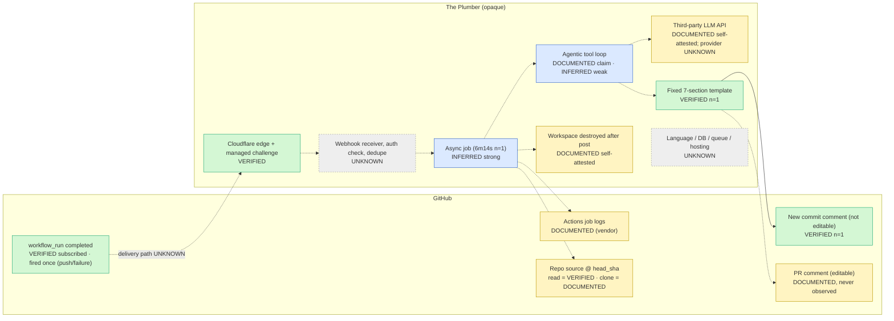
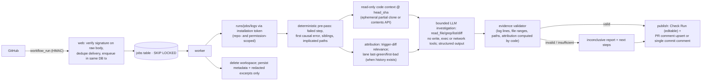

# Final Reverse-Engineering Audit: The Plumber (public-evidence edition)

| Field | Value |
|---|---|
| Date | 2026-10-17 |
| Session | Claude Code, opened in `~/tracewise` |
| Source rule | **Only unauthenticated, publicly accessible sources.** No `gh`, no token, no account, no private repositories, no App installs. |
| Supersedes | `research/FINAL-REVERSE-ENGINEERING-AUDIT.md` (same date, earlier session) **where they disagree**. That file and all other research files are unmodified. |
| Evidence | `research/final-audit-public/evidence/` (`FETCH-LOG.tsv` has every URL, time and HTTP code); REA ledger export `evidence/rea-evidence-bundle-2026-10-17.json` |
| Provenance | `research/final-audit/PROVENANCE-QUARANTINE.md`; `research/final-audit-public/provenance/` |

Companion deliverables: [VERIFIED-FEATURE-SPEC.md](VERIFIED-FEATURE-SPEC.md) · [TRACEWISE-PARITY-ACCEPTANCE-TESTS.md](TRACEWISE-PARITY-ACCEPTANCE-TESTS.md)

## Evidence classes

| Class | Meaning |
|---|---|
| **VERIFIED** | Directly observed by us from a public, unauthenticated source, or a REA capture we ran |
| **DOCUMENTED** | Stated by the vendor (Marketplace listing, its self-attested Transparency tab, report text) or by GitHub's public docs (marked "GitHub") |
| **INFERRED** | A reasoned hypothesis from indirect evidence |
| **UNKNOWN** | The evidence does not support a reliable conclusion |

---

## 1. Executive verdict

1. **Evidence base corrected.** The earlier 2026-10-17 audit relied partly on authenticated GitHub access through an account the user did not intend to use.
   - All of that evidence is quarantined (see PROVENANCE-QUARANTINE.md).
   - Every competitor finding was **re-established from public sources**, with identical results. The one exception: "demo logs expired (410)" is downgraded to INFERRED.
   - The 15-case real-world benchmark built from authenticated log downloads is **not admissible** in its current form.
2. **New public evidence** comes from the Marketplace Transparency tab, captured by REA and also embedded in the listing's page data. It has never been used before:

   | Field | Value | Status |
   |---|---|---|
   | Third-party services used | "AI inference provider (LLM API)" | Self-attested |
   | Repository visibility | Private | Self-attested |
   | Disclosure | Logs and code are not stored after analysis; the environment is destroyed after posting | Self-attested |
   | Publisher 2FA | Required | Verified by GitHub |
   | `llmsInUse` | Empty: no model named | — |
   | Permissions | Repository read on actions, checks, code and metadata; read/write on pull requests; plus a User scope "read access to public repositories…" | Verified by GitHub |

3. **The observable product is small and well bounded.**
   - A GitHub App with read-mostly permissions, triggered by `workflow_run`.
   - It posts one fixed-template markdown "Plumbing Report": observed once, as a commit comment, and advertised for PRs.
   - It uses a third-party LLM API (self-attested).
   - Everything else in the backend is UNKNOWN. Every vendor-hosted surface (theplumber.dev, api.theplumber.dev) is behind a Cloudflare managed challenge, re-observed today (REA `ev_069567c3…`).
4. **There is still exactly one public sample of real output**, and it is six months old (2026-04-14). Its diagnosis and fix are correct (re-checked arithmetically). It contains no attribution: it reported on a README-only commit. **No competitor experiment has ever been run.**
5. **Decision: READY AFTER SPECIFIC CORRECTIONS** (§12). The observable workflow is understood well enough to implement and test core parity. The corrections are:
   - the earlier plan's scope gaps (unchanged from the prior audit, spot-checked);
   - the evidence-hygiene items introduced by this audit;
   - re-sourcing the real-world benchmark.

---

## 2. Audit of prior work

### 2.1 Sessions and what they did

| Session | Opened in | GitHub auth | REA usage | Experiments | Output |
|---|---|---|---|---|---|
| S1: original research and plan, 2026-10-15 | `~/tracewise` | **None** (`gh` logged out; unauthenticated curl, 60 req/h) | MCP: `binary_session` ×2; `capture_browser_scenario` ×2 (theplumber.dev blocked, `ev_bd805a79…`; FailBrief OK, `ev_02389147…`) | None | `01`–`08`, EXECUTIVE-SUMMARY, IMPLEMENTATION-PLAN and companions |
| S2: earlier final audit, 2026-10-16/17 | `~/rea` | **`ksingh-rovn`** via `gh`, unintended | CLI `capture-browser-scenario` ×4 (MCP did not connect in that session) | Mined 15 public CI failures (authenticated) | `research/FINAL-REVERSE-ENGINEERING-AUDIT.md`, `VERIFIED-FEATURE-SPEC.md`, `TRACEWISE-PARITY-ACCEPTANCE-TESTS.md`, `final-audit/` |
| S3: this audit, 2026-10-17 | `~/tracewise` | **None** | MCP: `get_evidence_bundle`, `capture_browser_scenario` ×3, `export_evidence_bundle` | Public re-fetch of all competitor artifacts; provenance trace | This directory |

### 2.2 Classification of prior findings

| Category | Items |
|---|---|
| **Independently verified (now, publicly)** | App manifest; org and fork lineage; the single bot report (byte-identical); run, job and commit timeline; README-only trigger commit; upstream red history; Marketplace listing (installs, price, claims); Cloudflare block on the vendor site and API; DNS and CT edge facts (S2's public curl captures; not re-run) |
| **Vendor claims** | Clone of the repository; "agentic analysis"; PR-comment delivery; data destroyed after the report; under 2-minute latency; third-party LLM API; private source repo |
| **Inference** | Asynchronous processing (strong); LLM read the code (strong; the report quotes non-log source); tool loop or fixed read window (weak); latency typicality (none) |
| **Never investigated before S3** | Marketplace Transparency tab and the embedded listing JSON; Common Crawl; the unauthenticated GitHub search re-run of S2's queries; provenance of S2's evidence |
| **Investigated unsuccessfully** | theplumber.dev and api.theplumber.dev content (Cloudflare challenge); Wayback (0 snapshots); archive.today (404); Common Crawl (May index: no captures; April, June, July and September indexes: 504); demo job logs (publicly 403) |
| **Excluded by S3** | All S2 `gh`/GraphQL artifacts (superseded by public copies); F19's 410; authenticated code and commit search; benchmark R-01…R-15 ground truth |

### 2.3 Errors and overstatements found in prior work

| ID | Where | Problem | Correction |
|---|---|---|---|
| E-1 | S2 audit §3.1, §4 F5/F6/F19, §7.2 | Evidence obtained through an unintended account; this was not disclosed as unintended | Quarantined; replaced by public evidence (§4) |
| E-2 | S2 F19 | "Logs expired (410)" was presented as VERIFIED | INFERRED. The public request gets 403. 90-day default retention is documented by GitHub. |
| E-3 | S2 §7.2, spec and tests | Real-world cases presented as verified ground truth | Not admissible until re-validated with an approved credential (§7) |
| E-4 | S2 F5 / 01 §1 | "Not verified" publisher | Nuance: `isVerifiedOwner=false`, but the org's profile domain `theplumber.dev` **is** verified and 2FA is required (P-10) |
| E-5 | S2 spec FS-EVT-3 | "25 MB (GitHub's maximum payload)" was unverified | Now DOCUMENTED (GitHub): "Payloads are capped at 25 MB." |
| E-6 | S2 spec FS-RPT-10 | "GitHub limit 65,536" stated as fact | Not in GitHub docs; community-reported only. Keep a conservative cap. |
| E-7 | S2 spec FS-EVT-1 | Includes `startup_failure` as an analysable conclusion | Whether GitHub emits `workflow_run.completed` for startup failures is **UNVERIFIED**. Keep as a LIVE test. |
| E-8 | 01 §2 (S1) | Inferred commit comments need `contents:write` | Already corrected by S1's DECISION-REGISTER DR-39 and S2 C-R6. Re-confirmed today from the public docs copy: create = Contents **read**; edit/delete = Contents **write**. |
| E-9 | S2 §1 | "Its only possible output surfaces…" | Correct given the permissions. Also note the GitHub-verified **User** permission scope (P-9), which S2 missed. |

The S2 corrections to the implementation plan (C-P1…C-P19) were spot-checked against the plan files. C-P1, C-P8, C-P9, C-P12 and C-P14 are confirmed as stated. They are carried forward in §11.

---

## 3. What this audit did

### 3.1 Capability ledger

| Capability | Exists | Used | Target | Outcome | Evidence |
|---|---|---|---|---|---|
| REA MCP `capture_browser_scenario` | Yes (MCP connected) | **Yes ×3** | `theplumber.dev/` | 307 → 403 → Turnstile challenge; no first-party content | `ev_069567c3b141f80e8a62a8e7a73e212d1edeff5b0f231e49ba57d08587daa547` |
| | | | Marketplace `?tab=transparency` | Accessibility tree, Publisher section | `ev_cd63f2df93cd6837be39e3df6a4ad32776081bcc0154ee801dbd27ceb3d6b01c` |
| | | | Same, with clicks expanding "2. Permissions" and "3. Security & Compliance" | Full Transparency content | `ev_ee40b4dc9bdd44d9d226e8358409bfce14106efe52ba231ea77b0081ce9ab0ff` |
| REA `export_evidence_bundle` | Yes | Yes | Session ledger (3 records) | Exported | `evidence/rea-evidence-bundle-2026-10-17.json` |
| REA `get_evidence_bundle` | Yes | Yes | Prior ledger | **Empty**. The server restarted, so S1 and S2 evidence IDs survive only in saved JSON files. | — |
| REA `analyze_web_bundle`, `export_web_scripts`, `inspect_web_page`, source maps, JS app graph | Yes | **No** | — | No first-party JavaScript is reachable (challenge only). Analysing Cloudflare's challenge scripts would not describe The Plumber. | — |
| REA HAR / pcap inspection | Yes | No | — | No first-party traffic exists to capture | — |
| REA native, Android and firmware tools | Partly configured | No | — | No shipped binary to inspect | — |
| GitHub REST, **unauthenticated** (curl) | Yes | **Yes, 21 calls** | App, org, demo repo, comments, commits, runs, jobs, PRs, issues, forks, upstream; search ×4 | All 200, except logs (403) | `evidence/*.json`, `FETCH-LOG.tsv` |
| `raw.githubusercontent.com` | Yes | Yes ×7 | Demo source at `b2ef8a12` | 200 | `evidence/raw/` |
| Marketplace HTML and embedded JSON | Yes | Yes | Listing page | 200; listing object extracted | `evidence/marketplace.html`, `evidence/marketplace-embedded-listing.json` |
| GitHub public docs | Yes | Yes | Webhook payloads; permissions table (S2's public curl copy re-parsed); commit-comments REST page | 25 MB cap; `workflow_run.completed` "regardless of…"; comment permissions | `final-audit/evidence/gh-perms.md` (public); WebFetch log in this audit |
| Common Crawl index | Yes | Yes (1 pass, 5 indexes) | `theplumber.dev` domain | May and August: no captures; other indexes 504 | `evidence/commoncrawl-index-results.txt` |
| Wayback CDX / archive.today | Yes | Yes | `theplumber.dev*` | 0 snapshots / 404 | Session log (2026-10-17) |
| In-app browser with a human passing the Turnstile check | Yes | **No** | — | Needs the user to tick the checkbox themselves | §12 |
| Installing The Plumber on a test org | Possible | **No** | — | Needs the user's approval and an account | §12 |

**Not done, by rule:**

- bypassing or automating the Cloudflare challenge;
- POSTing to vendor endpoints;
- authenticated GitHub access;
- contacting the vendor;
- profiling the individual developer.

---

## 4. Findings register (public evidence only)

`evidence/` paths are relative to `research/final-audit-public/`.

| # | Claim | Class | Source / artifact | Method, date | Proves | Does not prove | Corroboration | Confidence |
|---|---|---|---|---|---|---|---|---|
| P-1 | App `the-plumber-app` (id 3376027): `actions:read`, `checks:read`, `contents:read`, `metadata:read`, `pull_requests:write`; events `workflow_run`; created 2026-04-14, updated 2026-04-15T22:57:14Z | VERIFIED | `evidence/app-manifest.json` | Unauthenticated REST, 2026-10-17 | The current manifest | Permissions exercised; permissions at the demo date | S1 fetch 2026-10-15 (same); GitHub-verified Transparency permissions table (P-9) | High |
| P-2 | Output surfaces possible with P-1: a **new** commit comment (Contents read); create **and edit** PR or issue comments (Pull requests write); **no** Check Runs (Checks write needed); **cannot edit or delete** commit comments (Contents write needed) | DOCUMENTED (GitHub) + P-1 | `final-audit/evidence/gh-perms.md` (public curl of GitHub docs, S2) | Parsed table | The feasible surfaces | What it actually does on PRs | — | High |
| P-3 | Exactly one public report: a commit comment by `the-plumber-app[bot]` on `theplumber-dev/coffee_shop@b2ef8a12`, 2026-04-14T14:49:20Z, 2,218 chars, `path` and `line` null, never edited | VERIFIED | `evidence/commit-comments.json` | Unauthenticated REST | Format and content of one report | Typical output | Unauthenticated search: 0 bot comments in issues/PRs, 4 queries (P-12) | High (n=1) |
| P-4 | Report sections: Summary (failed step as a **command**, root cause, Confidence "High", Fix complexity); What Failed; Why It Failed; Problematic Code (path + "lines 41" + snippet); Recommended Fix; Files Examined (path, range, verdict); For AI Agents (edit steps + verify command); footer | VERIFIED (text) | same | Read | The schema of one report | Variants for other failure kinds | Marketplace lists the same section names (DOCUMENTED) | High |
| P-5 | Diagnosis and fix are correct. `pricing.py:41` `total = subtotal * TAX_RATE`. The buggy outputs 0.21/0.68/0.87/0.96 vs expected 2.71/8.68/11.07/12.21. The proposed `subtotal*(1+TAX_RATE)` reproduces all four. | VERIFIED | `evidence/raw/*` + arithmetic | Source at SHA + computation | Correctness on this case | Generalisation | — | High |
| P-6 | Timeline: `3019c977` (14:21:19Z) added `pricing.py` and the tests. Upstream CI failed on `3019c977` (14:24:58Z) and `585de1d2` (14:28:20Z). Fork created; `b2ef8a12` (14:42:43Z) changes **only README.md (+3)**. Run 24405466283 failed; job completed 14:43:01Z; run updated 14:43:06Z; report at 14:49:20Z (**6 m 14 s**). | VERIFIED | `evidence/commits.json`, `commit-b2ef8a12.json`, `commit-3019c977.json`, `upstream-runs.json`, `runs.json`, `run-jobs.json` | Unauthenticated REST | Latency and context of this event | Typical latency; manual vs automatic trigger | — | High (n=1) |
| P-7 | The report gives no attribution: nothing says the push was README-only or that the bug pre-dated it. The fork had no prior in-repo runs, so lane-history methods would have no baseline here; a trigger-diff check would still apply. | VERIFIED (absence in text) | P-3 + P-6 | Comparison | The gap on this case, in April 2026 | Current behaviour (backend may have changed; the App manifest has not) | — | High (n=1) |
| P-8 | Report artifacts: paths prefixed `coffee_shop/coffee_shop/`; `order.py (lines 1-200)` on a 30-line file; `pricing.py (lines 1-43)` = full length; failed step shown as the command `pytest --tb=short -v` while the workflow step is named **"Run pytest"** | VERIFIED (text vs `evidence/raw/*`) | — | Comparison | Paths and ranges are not normalised to repo-truth; the step is identified by command | How they were produced (tool loop vs inline prompt vs model text) | — | High (text) / UNKNOWN (cause) |
| P-9 | GitHub-verified Transparency → Permissions: Repository "read access to actions, checks, code, and metadata"; "read and write access to pull requests"; **User** "read access to public repositories, public organization information, and public user profile data" | VERIFIED (GitHub-rendered) | REA `ev_ee40b4dc…` | REA capture with expand clicks | What GitHub states the App can access | Whether the App ever uses user-to-server tokens | P-1 | High |
| P-10 | Publisher: developer "theplumber.dev"; company domain theplumber.dev (verified profile domain); EU trader: No; status page `api.theplumber.dev/health`; ToS, privacy and support on theplumber.dev; publisher org requires 2FA; `isVerifiedOwner=false` | VERIFIED (GitHub-rendered; publisher data per GitHub) | `ev_cd63f2df…`, `evidence/marketplace-embedded-listing.json` | REA + HTML | Listing metadata | Content of the linked pages | — | High |
| P-11 | Self-attested Security & Compliance: third-party service "AI inference provider (LLM API)"; repository visibility Private; disclosure: no user code or CI log stored after analysis; environment destroyed after each report; reports may contain errors. GitHub notes this section is self-attested. `llmsInUse` is empty. | DOCUMENTED (self-attested) | `ev_ee40b4dc…`, embedded JSON | REA + HTML | The vendor's claims | Which provider or model; actual retention | Marketplace README privacy paragraph (same claim) | Medium |
| P-12 | No public PR or issue comments by the bot are indexed | VERIFIED (bounded) | `evidence/search-*.json` (4 queries, all `total_count` 0, `incomplete_results` false) | Unauthenticated search API | No indexed issue/PR comments | Commit comments (not searchable); private repos | S1 subagent (2026-10-15) also got 0 unauthenticated | Medium-high |
| P-13 | Marketplace: **4 installs**; one plan, Free $0: 10 analyses/month, public repositories, "Full Plumbing Report on every failure", "Commit & PR comments"; 9 languages listed; categories CI and AI Assisted | VERIFIED (GitHub-displayed) | `evidence/marketplace.html`, `ev_cd63f2df…` | HTML + REA | The listing today | Off-Marketplace plans (site blocked) | Same on 2026-10-15 | High |
| P-14 | Vendor pipeline claim: download CI log → clone repo at the failing commit → "agentic analysis through the actual codebase" → report on commit or PR "in under two minutes"; "No config changes… No dashboard" | DOCUMENTED | Embedded `extendedDescription` | HTML | The claim | Mechanism | P-3/P-8 are consistent with code being read | Medium |
| P-15 | theplumber.dev and api.theplumber.dev: Cloudflare managed challenge on every probed path | VERIFIED | `ev_069567c3…` (today); S2 public curl probes `final-audit/evidence/site-paths.txt` (2026-10-16) | REA + curl | Nothing first-party is reachable without a human check | Origin stack | S1 `ev_bd805a79…` (2026-10-15) | High |
| P-16 | Edge: Cloudflare A/AAAA, NS and Email Routing MX; SPF only; CT names only apex + wildcard, first certificate 2026-04-12 | VERIFIED (S2 public DoH/crt.sh, unauthenticated; not re-run) | `final-audit/evidence/dns.txt`, `crtsh.json` | DoH, crt.sh | Edge provider only | Origin hosting, framework, DB, queue, LLM vendor | — | High (edge) |
| P-17 | Demo job logs are not publicly retrievable (**403**, auth required). Expiry is INFERRED from GitHub's 90-day default retention (the run is 186 days old). | VERIFIED (403) / INFERRED (expiry) | `evidence/run-logs-unauth.txt`, FETCH-LOG | Unauthenticated REST | The "What Failed" excerpt cannot be re-checked against the raw log | — | — | High / Medium |
| P-18 | No archive copy of theplumber.dev: Wayback 0 snapshots; archive.today 404; Common Crawl 2026-21 and 2026-34 "No Captures"; other indexes unavailable (504) | VERIFIED (bounded) | `evidence/commoncrawl-index-results.txt`; session log | Public archives | No pre-challenge copy found | That none exists | — | Medium |
| P-19 | Workflow: `push` (all branches) and `pull_request`; one job "Tests (Python 3.11)" on `ubuntu-latest`; step "Run pytest" runs `pytest --tb=short -v` | VERIFIED | `evidence/raw/.github_workflows_ci.yml`, `run-jobs.json` | Raw + REST | Demo context | — | — | High |

---

## 5. Reconstructed workflow by stage

| Stage | Observable answer | Class | What remains unknown |
|---|---|---|---|
| **A. Install** | Marketplace → Install GitHub App (Free). All or selected repos (GitHub-stated). No config file. | VERIFIED (listing) / DOCUMENTED | Behaviour on uninstall, suspend, missing permission, or a private repo on the free plan |
| **A. Permissions** | P-1, P-9 | VERIFIED | Whether the User scope is ever used |
| **A. Trigger** | `workflow_run` (P-1). `completed` fires "regardless of whether the workflow was successful or unsuccessful" (DOCUMENTED, GitHub). It fired on a push failure once (P-6). | VERIFIED + DOCUMENTED | Handling of `timed_out`, `cancelled`, `startup_failure`, re-runs, PR runs |
| **B. Ingestion** | Report 6 m 14 s after the run completed. Webhook responses are expected within 10 s (DOCUMENTED, GitHub). | INFERRED (strong): asynchronous | Queue, retries, dedupe, signature check. Re-runs would create new commit comments, which cannot be edited (P-2). |
| **C. Logs** | Vendor: "Downloads the CI log". The report quotes a pytest line consistent with the source. | DOCUMENTED + consistent | Log size limits; which jobs |
| **C. Code** | Vendor: "Clones the repository at the failing commit". The report quotes `pricing.py:41`, which is not in any log. | DOCUMENTED (clone) / VERIFIED (code was read) | Clone vs API; size limits; file selection |
| **C. History** | No commit or run references in the report | UNKNOWN (no positive evidence) | — |
| **D. Analysis** | Primary error = first failing assertion; 3 siblings grouped; mechanism, location and fix correct (n=1). Third-party LLM API (self-attested). | VERIFIED (n=1) / DOCUMENTED | Agent vs pipeline vs single call (vendor says "agentic"; artifacts ambiguous). Behaviour on other failure classes. |
| **E. Report** | Fixed template (P-4). Commit comment (seen); PR comment (advertised). No links back to the run or job. | VERIFIED / DOCUMENTED | PR-comment format and update behaviour; inconclusive or failure output |
| **F. Security and privacy** | Least privilege apart from `pull_requests:write`; no code write. Publisher 2FA required (verified). Retention and cleanup are self-attested. | VERIFIED / DOCUMENTED | Webhook authenticity, credential handling, isolation, prompt-injection defences, monitoring |
| **G. Backend** | Cloudflare edge; `api.` host; third-party LLM API (self-attested); private source repo (self-attested) | VERIFIED (edge) / DOCUMENTED | **Language, framework, database, queue, hosting origin, LLM vendor and model, observability: UNKNOWN. Not asserted.** |

---

## 6. Part A: The Plumber, evidence-classified

Only TPL → CC is a solid (observed) edge; every other edge is inferred or claimed. No database, queue, framework or model is drawn because none is evidenced.

---

## 7. Failure scenarios and benchmark

### 7.1 Competitor output actually observed

| Case | Ground truth (public) | Plumber output | Correct? | Attribution | Evidence quality | Uncertainty | Latency |
|---|---|---|---|---|---|---|---|
| coffee_shop `b2ef8a12` | Bug at `pricing.py:41`, introduced in `3019c977`; red since its first upstream run; trigger README-only; no in-repo history | Correct mechanism, line and fix | ✅ | ❌ no "pre-dates this push" | Quotes the assertion and the exact code line; path prefix wrong; range artifacts | "High", no basis given | 6 m 14 s |

**This is the only competitor data point.** None of the 8 requested scenarios has been run against The Plumber.

### 7.2 Real-world benchmark status

The 15 cases R-01…R-15 mined in S2 depend on **authenticated log downloads**, so they are **excluded as ground truth**. Public job logs require authentication (P-17), so their ground truth cannot be re-established without a credential.

The repositories, run IDs and case descriptions are preserved in `final-audit/evidence/benchmark/INDEX.md` as **candidates** for future re-validation.

**Re-validation options** (needs a user decision; see §12):

1. A **project-scoped fine-grained token**, read-only on public repositories, created by the user for this project. Re-download and re-label 5–15 cases, with a human re-label of at least 5.
2. **Synthetic cases only**, in our own test org. These need an account and org approved by the user.
3. **Public run metadata only.** Without authentication we can still read runs, jobs, commit diffs and compares for public repos (60 requests/hour). This supports *attribution* ground truth (which commit, pre-existing or not, same-SHA rerun green) but **not** error-line ground truth.

**Scenario coverage plan** (ground truth to be built under whichever option is approved):

| # | Scenario | Planned source |
|---|---|---|
| 1 | Trigger-introduced | Synthetic B-01/B-02-C1; real candidate R-05/R-12 |
| 2 | Pre-existing | Synthetic B-02-C2; candidate R-04 |
| 3 | README/unrelated change then failure | Synthetic B-02-C2; the coffee_shop replica; candidate R-02 |
| 4 | Dependency or lockfile | Synthetic B-05/B-06; candidates R-06/R-15 |
| 5 | Flaky | Synthetic B-04; candidate R-10 |
| 6 | Environment or runner | Candidates R-07/R-08; synthetic not feasible for runner-image drift |
| 7 | Misleading first or last error | Synthetic B-12; candidates R-02/R-13 |
| 8 | Abstain | Synthetic B-14; candidate R-14 |

### 7.3 Testing the competitor

This requires all of the following:

1. A test org and account named by the user.
2. Explicit approval to install `the-plumber-app` on public synthetic repos.
3. Building the cases with `truth.yaml` committed first.

The free tier allows 10 analyses/month, enough for one pass of about 8 cases. **Not done.**

---

## 8. Part B: Tracewise (separate design)

Our design; no claim about The Plumber. The full specification is in [VERIFIED-FEATURE-SPEC.md](VERIFIED-FEATURE-SPEC.md).

| Decision | Type | Why |
|---|---|---|
| GitHub App on `workflow_run` | Required for parity | P-1 |
| Read logs and code at `head_sha` | Required for parity | P-5 (a line-level fix needs code) |
| LLM investigation with read-only tools, bounded | Required for parity on novel failures | P-4/P-5; vendor-attested LLM use (P-11) |
| Commit comment on push; PR comment on PR | Required for parity | P-3, P-13 |
| Check Run in addition | Improvement | Editable; avoids duplicate re-run comments (P-2) |
| Trigger-diff relevance plus lane attribution | Differentiation | P-7 |
| Evidence validator and abstention | Differentiation and safety | P-4 confidence has no basis |
| Deterministic pre-pass | Implementation choice | Testable; fewer tokens |
| Clone vs contents API | Implementation choice | Either, if AT-CTX passes |
| Sandbox execution, fix PRs, dashboard, billing | Out of MVP | The competitor has none either (P-14); risk |

---

## 9. Challenging the original findings

| Conclusion under test | Challenge | Result |
|---|---|---|
| "The Plumber uses an agentic tool loop" | Do the artifacts prove a loop? | **No.** Ranges `1-43` and `1-200` are inconsistent with a fixed read window, and could be model-written. The vendor claims "agentic" (DOCUMENTED). **Keep as DOCUMENTED claim / weak inference; do not design to it.** |
| "It clones the repo" | Is there independent proof? | No. The vendor states it twice (README and Transparency). The report proves code was *read*, not how. |
| "It misses attribution" | n=1? Current? | **n=1, April 2026.** It cannot be generalised, and current behaviour is unknown. The App manifest is unchanged since 2026-04-15, but backend changes are invisible. **Do not market "The Plumber can't attribute" without AT-CMP-01.** |
| "Latency ≈6 min vs <2 min claimed" | Representative? | n=1, launch day, possibly manual. Use only as an anecdote. |
| "4 installs, free only" | Current? | **Yes, re-observed 2026-10-17** (public HTML + REA). |
| "No PR comments exist" | Searched? | 0 in the indexed issue/PR comment search (public). Absence ≠ never. |
| Benchmark realism | Are cases representative of 5–30-person teams? | Synthetic cases are ours. The real-world candidates are OSS and quarantined. **Representativeness is unproven.** |
| Plan scope (from the S2 audit) | Is code reading and an LLM "necessary"? | **Yes, for parity:** the competitor's core value is a line-level root cause and fix (P-4/P-5), which rules and lockfile-only reading cannot produce. Attribution remains the differentiator, not the whole product. |
| Plan permission set | Is `pull_requests:write` needed? | Needed only for PR-comment parity (advertised, never observed). A Check Run covers the PR UI. **Keep it as parity-required but explicit (OQ).** |

---

## 10. Remaining unknowns

| # | Unknown | How it could be resolved | Needs |
|---|---|---|---|
| U-1 | Backend stack, hosting origin, LLM provider and model, real retention, sub-processors | Vendor pages (privacy, terms, examples) behind Cloudflare | A human passing the challenge in a normal browser, or vendor contact (not done) |
| U-2 | Behaviour beyond one Python unit-test regression | AT-CMP-01 | Test org + App install (approval) |
| U-3 | Dedupe and re-run behaviour; non-`failure` conclusions | AT-CMP-01 | Same |
| U-4 | PR-comment format and editing | AT-CMP-01 with a PR | Same |
| U-5 | Typical latency | AT-CMP-01 ×N | Same |
| U-6 | Paid plans and terms | Vendor site | U-1 |
| U-7 | Whether `workflow_run.completed` fires for `startup_failure` (for our spec) | LIVE test in our org | Test org (approval) |
| U-8 | Exact GitHub comment and check-output length limits (for our spec) | LIVE test | Test org |

---

## 11. Corrections required

### 11.1 To the S2 deliverables (`research/*.md` dated 2026-10-17)

- Remove or quarantine all evidence obtained via `ksingh-rovn`. This includes F5/F6 (GraphQL), F19 (410), F12's code and commit search, and every R-case used as ground truth.
- Adopt E-2…E-9.
- Spec and tests: replace "REAL-SET" gates with re-validated or synthetic sets (see the new spec and tests).

### 11.2 To the implementation plan (carried from S2 C-P1…C-P19, spot-checked)

1. **Re-scope to "parity + attribution"** (C-P2, C-P3, C-P4, C-P19):
   - LLM root cause and text fix on by default;
   - bounded read-only code context;
   - Files Examined computed from actual reads;
   - a defined AI-agent block;
   - commit comment on push and PR comment on PR, plus a Check Run.
2. **Fix factual errors.**
   - C-P1 (verified): Plan §4.4.3 says there is no output channel without `pull_requests:write` or `issues:write`. Commit comments need only Contents read.
   - C-P9 (verified): T2.06 does not exist; it is T6.03.
3. **Add the trigger-diff relevance check** (C-P7). It works even without lane history (P-7).
4. **Resolve inconsistencies** (verified):
   - C-P8: the G-INT gate depends on T6.12, which is a Phase 6 task;
   - C-P12: $99 plan quota is 1,000 vs 1,500;
   - C-P14: staging soak is 7 vs 14 days.

   The others are carried as stated by S2.
5. **Add missing tasks** (C-P18), including log-spoofing defences and prompt-injection tests in the MVP rather than the optional Phase 4B.
6. **New from this audit:**
   - **Evidence hygiene:** a project-scoped credential policy; benchmark provenance recorded per case.
   - Verify `startup_failure` delivery (U-7) and length limits (U-8) in a live test org before relying on them.
7. **Re-estimate effort** bottom-up after re-scoping. S2's rough +5–7 dev-days is unverified.
8. **Commercial gate unchanged:** VALIDATE FIRST (willingness to pay is unproven).

---

## 12. Final decision

## **READY AFTER SPECIFIC CORRECTIONS**

The core observable workflow is established from public evidence alone. It covers:

- the trigger, the permission model and the feasible output surfaces;
- the inputs (logs plus code);
- the report schema and its content quality on the one public sample;
- the vendor's self-attested use of a third-party LLM.

Private internals are unknown, but parity does not need them. Implementation can start once the plan corrections in §11 are made and the benchmark is re-sourced.

| # | Item | Status |
|---|---|---|
| 1 | Provenance of all prior evidence traced; unintended authenticated evidence quarantined | ✅ Done (PROVENANCE-QUARANTINE.md) |
| 2 | All competitor findings re-verified from unauthenticated public sources | ✅ Done (P-1…P-19) |
| 3 | REA used via MCP: vendor site re-probed; Transparency tab captured; ledger exported | ✅ Done |
| 4 | Alternative public sources for the vendor site (Wayback, archive.today, Common Crawl) | ✅ Done (none found) |
| 5 | Platform constraints for the spec (permissions, payload cap) checked against GitHub docs | ✅ Done; comment and check length limits and `startup_failure` remain to be tested live |
| 6 | Feature spec and acceptance tests (public-evidence edition) | ✅ VERIFIED-FEATURE-SPEC.md, TRACEWISE-PARITY-ACCEPTANCE-TESTS.md |
| 7 | Plan corrections (§11.2) applied to the plan documents | ⬜ Outstanding (not edited, by instruction) |
| 8 | Bottom-up re-estimate after re-scoping | ⬜ Outstanding |
| 9 | Real-world benchmark re-sourced (option 1, 2 or 3 in §7.2) | ⬜ **Needs your decision** (credential or test org) |
| 10 | Competitor head-to-head (AT-CMP-01) | ⬜ **Needs your approval** (account, test org, App install). Optional for parity; required for any "better than The Plumber" claim. |
| 11 | Vendor site content (privacy, terms, examples) | ⬜ Optional. Needs you to pass the Cloudflare check yourself in a normal browser; I can then read the rendered page. |
| 12 | Commercial validation (G-0) | ⬜ Outstanding; unchanged |
