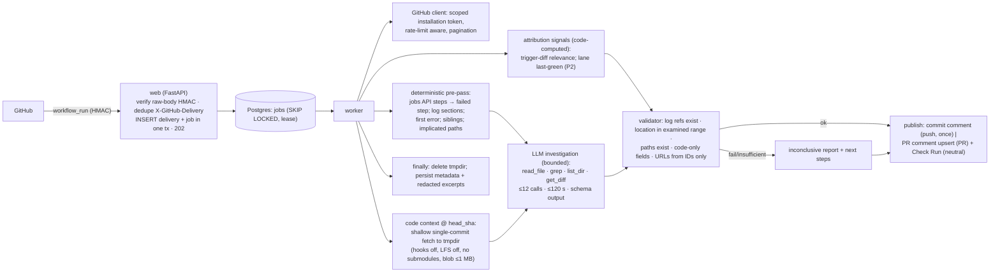

# Tracewise Architecture Review (first principles)

Date: 2026-10-17. This reviews `IMPLEMENTATION-PLAN.md` (S1) against `final-audit-public/VERIFIED-FEATURE-SPEC.md` (S3) and this review's platform evidence.

**Basis tags on each recommendation**

| Tag | Meaning |
|---|---|
| **[COMP]** | Required by verified competitor behaviour |
| **[PLAT]** | Required by GitHub platform behaviour |
| **[GOAL]** | Justified by Tracewise's own goals |
| **[HYP]** | Hypothesis to test |

EV-IDs are from [EVIDENCE-LEDGER.md](EVIDENCE-LEDGER.md).

## 1. Recommended MVP architecture

**Not in the MVP:** Redis, object storage, dashboard, OAuth users, billing, Slack, sandboxed test execution, fix PRs.

## 2. GitHub integration

| Recommendation | Basis | Notes and alternatives |
|---|---|---|
| Subscribe to `workflow_run` only; installation events arrive by default | [COMP] EV-C01; [PLAT] EV-P01, EV-P21 | — |
| Analyse `conclusion ∈ {failure, timed_out}` | [PLAT] EV-P01; [COMP] `failure` observed once | Add `startup_failure` only after G-PLAT-1 |
| Respond within 10 s; enqueue in the same DB transaction as the delivery row | [PLAT] EV-P05 | The alternative, an external queue, has a dual-write gap (rejected, ADR-03) |
| Dedupe on `X-GitHub-Delivery` and on `(repo_id, run_id, run_attempt)` | [PLAT] EV-P06 (same ID on redelivery); EV-P02 (re-runs) | — |
| Reconciliation: (a) redeliver failed deliveries via `/app/hook/deliveries`; (b) **also** list recent failed runs per enabled repo, because oversized events are never delivered | [PLAT] EV-P06, EV-P04 | (b) is new vs the plan. Costs API budget, so make it hourly and bounded. |
| No ordering assumption; idempotent upserts | [PLAT] EV-P08 | — |
| HMAC-SHA256 on raw bytes, constant-time; reject a missing header | [PLAT] EV-P07 | — |
| **PR association by API lookup, never from `workflow_run.pull_requests`** | [PLAT] EV-P10, EV-P23, EV-P24 | Same-repo: `GET /commits/{sha}/pulls`. Fork: `GET /pulls?head={owner}:{branch}`, filtered to `head.sha == head_sha`. G-PLAT-4. |
| Commit comment on push failures: write-once per `(repo, head_sha, workflow_id)` | [COMP] EV-C06; [PLAT] EV-P09 (create needs Contents read; edit needs write) | G-PLAT-5 |
| PR comment upserted per `(PR, workflow_id)`; find existing by an HTML marker in the body | [COMP] EV-C04 (advertised); [PLAT] EV-P09 | The marker must be ours and not forgeable by users: match the comment author = our App |
| Check Run (`neutral`), updated in place, ≤10 annotations | [GOAL] editable surface; [PLAT] EV-P10 | Optional for parity. Gives an update channel for re-runs and outcomes. |
| Insufficient-permission handling: 403 → record which permission, publish where possible, no retry loop | [PLAT] EV-P21 | G-PLAT-7 |
| Uninstall: stop on `installation.deleted`; in-flight jobs fail token mint → cancel without publishing; purge after grace | [PLAT] EV-P21 | G-PLAT-6 |
| Rate limits: per-analysis request budget, ≤2 concurrent per installation, honour reset headers | [PLAT] EV-P18 | — |

## 3. Log processing

| Recommendation | Basis | Risk addressed |
|---|---|---|
| Step boundaries and the failed step come from the **jobs API** (`steps[]` names, numbers, conclusions); log markers are used only to slice | [PLAT] EV-P25 (steps available); [GOAL] spoof resistance | Repo code can print fake `##[error]` / `##[group]` |
| Download logs per failed job only. Stream. Keep failed-step sections + ±200 lines around errors, ≤2 MB per job. Set `log_truncated`. | [PLAT] EV-P12 (1-min redirect); [GOAL] | Memory, cost |
| Strip ANSI and control characters (including OSC 8 hyperlinks and C1 controls) before parsing and rendering | [GOAL] | Terminal-escape injection into reports |
| Redact secrets (GitHub `***` plus regex and entropy) **before** storage and the LLM | [GOAL] | Secret leakage |
| Deterministic extractors (pytest, tsc, jest/vitest, ruff/mypy/eslint, generic) with time-bounded regexes; failure → generic tail | [GOAL] | ReDoS, parser crashes |
| Multiple failed jobs: rank by step order and timestamp; group by fingerprint; report ≤3 independent primaries | [COMP] EV-C07 (grouping, n=1); [GOAL] | Cascades and misleading tails |
| **Spoofed output:** never treat printed version strings or `##[error]` as authoritative for attribution without a structured corroborator | [GOAL] | Log spoofing (missing from the plan) |

## 4. Repository context

| Question | Recommendation | Basis |
|---|---|---|
| Which commit? | `workflow_run.head_sha`. For PR runs, note that CI tested the merge commit (the base may matter). | [PLAT] EV-P20, EV-P22 |
| Clone or API? | **Shallow single-commit fetch** into a per-job tmpdir: `git init`; `git fetch --depth=1 --filter=blob:limit=1m <url> <head_sha>` with an `x-access-token` installation token; `checkout`. Settings: `GIT_LFS_SKIP_SMUDGE=1`, `core.hooksPath=/dev/null`, `protocol.file.allow=never`, no submodule init. The API alternative (`contents`, `git/trees`) avoids disk but makes `grep` and listing expensive in calls. | [PLAT] EV-P17 (HTTP git with Contents), EV-P16. **[HYP]:** fetch-by-SHA works for fork PR heads in the base repo. Test with G-PLAT-4. |
| Read safety | Every tool path is resolved with `realpath` inside the workspace. Reject `..`, absolute paths and symlinks that resolve outside. Skip files >1 MB and binaries. Submodules are reported as "not inspected". | [GOAL]; [PLAT] EV-P16 (symlink and submodule types) |
| Deleted or renamed files | The tool returns `not_found`. The LLM must not cite them (validator). | [GOAL] |
| Monorepos and large repos | Cap repo size (e.g. 1 GB on disk) and fetch time. Fallback to the contents API for specific paths. | [HYP]: thresholds need measurement |
| Missing permission | Contents missing → diagnosis from logs only, `confidence ≤ medium`, `files_examined=[]` | [PLAT] EV-P21 |
| Cleanup | `finally` delete plus a startup sweep | [COMP] EV-C03 (vendor claims the same, self-attested); [GOAL] |

## 5. AI investigation

| Question | Recommendation | Basis |
|---|---|---|
| Enabled by default? | **Yes, for parity.** A line-level root cause and fix on arbitrary code cannot be produced by rules (EV-C07/C08). | [COMP] |
| Tools | Read-only `read_file(path,start,end)`, `grep(pattern,glob)`, `list_dir(path)`, `get_diff(base,head)`. **No** write, exec or network tools. ≤12 calls, ≤120 s, token cap. | [GOAL] |
| Output | Structured JSON schema (Diagnosis v2). Invalid → 1 repair attempt → `inconclusive`. | [GOAL] |
| **Valid citation vs causal support** | The validator proves the citations **exist**: log lines, file ranges, paths. It does **not** prove causation. Therefore: (1) causal fields such as `introducing_sha` and `trigger_touches_implicated` are code-computed only; (2) `high` confidence requires deterministic corroboration (the error references the location, or a changed line); (3) the benchmark grades causal correctness separately from citation validity. | [GOAL] |
| Confidence | Bands with a `basis[]` list from deterministic signals. No numeric probability until calibrated on ≥200 labelled cases. | [GOAL]; [COMP] EV-C07 (an unexplained "High") |
| Abstention | `inconclusive` when the validator fails, no error line is found, logs are truncated past the error, or the budget is exhausted. No fix in that case. | [GOAL] |
| Prompt injection (logs, files, commit and PR text, dependency output) | Delimited untrusted blocks; no side-effecting tools; schema-only output; code-built URLs; mentions escaped; injection fixtures in the **MVP** test suite | [GOAL] |
| Model and provider | Choose by evaluation on the synthetic benchmark: accuracy, confident-wrong rate, cost, p95 latency, data-retention terms. **Do not choose by recency.** Disclose provider and model family. | [GOAL]; [COMP] EV-C03 (competitor does not name its model) |

## 6. Attribution (signal, not proof)

**Definitions.** These four are **never conflated**:

| Term | Meaning |
|---|---|
| **First observed failure** | The earliest run in the lane with the same job/step (or fingerprint) failing |
| **First commit touching an implicated file** | A diff fact |
| **Triggering commit** | The `head_sha` of the analysed run |
| **Causal commit** | Ground truth only. The product can at most say "suspected" with a stated basis. |

**Trigger-diff relevance (MVP):**

- **Inputs:** the compare of the trigger vs its parent (push) or the merge base (PR), plus the implicated paths.
- **Outputs:** `touches_implicated` = true / false / unknown, plus a sentence.

| Case | Expected behaviour | Basis |
|---|---|---|
| README-only push after the bug existed | "Changed only README.md; not implicated; failure likely pre-dates this push" | [COMP] EV-C11 gap (n=1) |
| Trigger edits a docstring in the traceback file while the cause is upstream | `touches_implicated=true`, but it **must not** become "caused by". Precedence: lane history (same failure before the trigger) and dependency signals override it. Public example of the pattern: EV-P26. | [GOAL] |
| Flaky (same SHA passes on attempt 2) | The trigger signal is suppressed. `flaky_suspect` after the outcome. | [PLAT] EV-P02 |
| Pre-existing | Lane history (P2, deferred) says the same job/step failed before → "pre-dates this push", whatever the diff | [GOAL] |

**MVP scope:** trigger-diff relevance only. Lane history, flakiness and dependency drift are P2 and must be benchmark-validated first.

## 7. Data and operations

| Topic | Recommendation | Basis |
|---|---|---|
| Retention | Never persist raw logs or source. Redacted excerpts ≤2 KB for 90 days. Fingerprints and metadata ≤365 days. Purge on uninstall after a grace period. | [GOAL]; mirrors the competitor's self-attested claim (EV-C03) |
| Queue | Postgres `jobs` with `SKIP LOCKED`, lease, backoff, dead letter. One datastore. | [GOAL] (ADR-03) |
| Concurrency | Global worker cap; ≤2 per installation; advisory lock per `(repo, run)` | [PLAT] EV-P18 |
| Idempotency | Keys: delivery ID; `(repo, run, attempt)`; publish keyed by surface (commit comment once; PR comment marker; Check Run `external_id`) | [PLAT] EV-P02, EV-P06 |
| Observability | Per-stage timings, tokens, cost, publish result; failure-rate alert | [GOAL] |
| Quotas | Per-installation monthly quota; an over-quota notice on the Check Run only | [COMP] EV-C04 (10/month free); [GOAL] cost control |
| Tenant isolation | App-layer scoping now. Postgres RLS with transaction-local context **before the first external installation**. | [GOAL] (ADR-05) |
| Credentials | Only project-scoped App credentials. No personal or global CLI tokens in services, tests or benchmarks. | [GOAL]; S3 provenance incident |

## 8. Security analysis (top threats)

| Threat | Control | Test |
|---|---|---|
| Forged or replayed webhook | HMAC + delivery dedupe | AT-SEC-02 |
| Prompt injection via logs or code | No side-effecting tools; schema; validator; escaped rendering | AT-SEC-08–10 |
| Log spoofing (fake markers or versions) | Jobs API for steps; corroboration rule | AT-SEC-11 |
| Path traversal or symlink escape in the workspace | `realpath` confinement | AT-CTX-03, AT-SEC-09 |
| Malicious repo content at checkout (hooks, LFS, filters, submodules) | Hooks disabled; LFS skipped; no submodules; no build or exec | AT-CTX-01 |
| Secret leakage | Redaction before storage and LLM | AT-SEC-04 |
| Token misuse | Scoped 1-h tokens, memory-only | AT-SEC-05 |
| Cross-tenant access | Tenant key from `installation.id`; RLS before external | AT-SEC-03 |
| Report injection (mentions, HTML, links, terminal escapes) | Escape and strip; code-built URLs | AT-SEC-07 |

## 9. Unresolved decisions

| ID | Decision | Options | Default proposed | Depends on |
|---|---|---|---|---|
| UD-1 | Check Run in the MVP? | Yes (needs `checks:write`) / No | Yes: it is the only editable surface on push failures | Product judgement |
| UD-2 | Clone vs API for code context | Shallow fetch / contents API | Shallow fetch | G-PLAT-4, measurement |
| UD-3 | Model and provider | Candidates chosen by evaluation | Decide after the synthetic benchmark | Benchmark run |
| UD-4 | `startup_failure` support | — | Excluded until G-PLAT-1 | Live test |
| UD-5 | Live test environment | A project-scoped test org and dev App, created by the user | **Not created**; awaiting approval | User |
| UD-6 | Benchmark log source | Synthetic only (decided by the user) | Synthetic plus public metadata | — |
